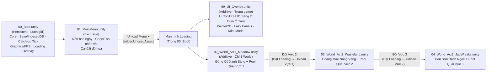

# KIẾN TRÚC ĐA SCENE, BẢN ĐỒ SÁNG, ĐỒ HỌA 3D & DEMO WEB LAN (V2 — ĐÃ CHỐT)
> **Dự án:** Khí Vận Chi Tử (Commercial Remake)  
> **Nền tảng Demo Mốc 1:** Local WebGL trên **iPhone Safari** & **Laptop Browser** qua mạng LAN (`Tools/LocalServer`)  
> **Công nghệ UI:** **UI Toolkit (`UXML` + `USS` + C# + `Painter2D`)** — Tông màu **SÁNG**, HUD **2 cụm ô tròn đóng/mở**, hỗ trợ **Taskbar Mini-Mode**, giữ nguyên 100% vị trí hình ảnh cho Codex render.

---

## 1. KIẾN TRÚC ĐA SCENE & QUY TẮC LOAD/UNLOAD TRÁNH LAG (WEBGL / IPHONE / MOBILE)

> [!IMPORTANT]
> **Giới hạn sống còn trên iPhone Safari:** Trình duyệt WebKit trên iOS tự reload tab nếu tiến trình WebGL vượt ngưỡng **~300–512 MB RAM**. Do đó kiến trúc bắt buộc tách Scene rõ ràng, chỉ giữ đúng **1 World Scene** tại một thời điểm và ép nén toàn bộ texture ngay từ khâu import.

### Phân bổ từng Scene & Quy tắc chống khựng khung hình

| Scene | Chế độ Load | Nội dung bên trong | Quy tắc Load / Unload chống Lag |
| :--- | :---: | :--- | :--- |
| **`00_Boot.unity`** | **Single (Gốc)** | `GameBootstrap`, `SaveService` (kèm `.jslib` flush `IndexedDB`), `BackgroundCatchupService` (`UtcNow`), `AudioService`, `GraphicsSettingsService`, `FpsMonitorService`, `SceneFlowController`, `NetworkBridge` (Nakama LAN), và **Loading Overlay**. **0 geometry 3D.** | Load đầu tiên; giữ xuyên suốt. |
| **`01_MainMenu.unity`** | **Additive** | Nền sáng ban ngày `bg_main_menu_daylight`, UI Chọn/Tạo nhân vật (kèm cầu nối bàn phím ảo iOS) & Cài đặt nhanh. | **Unload ngay lập tức + `Resources.UnloadUnusedAssets()`** khi vào chơi để giải phóng sạch RAM nền Menu. |
| **`99_UI_Overlay.unity`** | **Additive** | `UIDocument` chính: HUD sáng 2 cụm ô tròn (`☯` & `≡`), bong bóng Chat, FPS Pill, Thẻ Nhiệm Vụ 1 dòng, Ô tròn Kỹ Năng. Các cửa sổ lớn (*Cây Đạo Vận, Kiếm Lộ, Luyện Đan, Trang Bị, Trận Pháp, Xã Hội*) chỉ **mount/refresh khi đang mở**. | Load 1 lần khi vào trận; tự chuyển sang **Taskbar Mini-Mode** khi cửa sổ Web thu nhỏ `< 480px`. |
| **`02_World_Act1_Meadow.unity`** | **Additive** | Môi trường **Đồng Cỏ Xanh Sáng** (3 chunk mesh nhẹ, không dùng `Terrain`), Lighting ban ngày, Camera 3D, Player, Pool Phi Kiếm, và **chỉ Pool Quái + Boss Vực 1**. | Load cho Vực 1 (Ải 1–10). **Chuyển ải trong cùng Vực 1 KHÔNG reload scene** (0ms khựng). Unload hoàn toàn trước khi sang Vực 2/3. |
| **`03_World_Act2_Wasteland.unity`** | **Additive** | Môi trường **Hoang Mạc Nắng Vàng** + **chỉ Pool Quái + Boss Vực 2**. | Bật Loading → Unload Vực 1 → Dọn RAM → Load Vực 2. |
| **`04_World_Act3_JadePeaks.unity`** | **Additive** | Môi trường **Tiên Sơn Bạch Ngọc** + **chỉ Pool Quái + Boss Vực 3**. | Bật Loading → Unload Vực 1/2 → Dọn RAM → Load Vực 3. |

---

## 2. PIPELINE HÌNH ẢNH CODEX & KỸ THUẬT UI TOOLKIT NÂNG CAO

### 2.1 Cơ chế tự nhận & tự nén ảnh Codex an toàn cho WebGL (`Resources/CodexDrop`)
> [!WARNING]
> **Điểm kỹ thuật đã hiệu chỉnh:** Trong bản build WebGL/APK, Unity sẽ cắt bỏ mọi ảnh nằm ngoài `Resources` nếu chưa kéo tay vào Inspector. Vì vậy toàn bộ ảnh Codex được đặt tại **`Assets/_Game/Resources/CodexDrop/`** đi kèm 2 công cụ tự động:
1. **`CodexArtImportPostprocessor.cs` (Editor):** Ngay khi thả ảnh Codex vào `Assets/_Game/Resources/CodexDrop/` *(hoặc nếu một phiên Codex cũ thả nhầm vào `Assets/_Game/Art/CodexDrop/`, script sẽ tự động chuyển file sang `Resources/CodexDrop/`)* và cấu hình:
   - `MipMaps = false` cho toàn bộ ảnh UI (tiết kiệm **33% VRAM** trên iPhone Safari!).
   - `AlphaIsTransparency = true`, `MaxSize = 256` cho vật phẩm/nút tròn, `512` cho bảng 9-slice, `1024–2048` cho nền/skybox, bật nén chuẩn cho WebGL & Mobile.
2. **`CodexArtLoader.cs` (Runtime):**
   - Tự tìm ảnh trong `Resources/CodexDrop/<path>` (hoặc ảnh tái sử dụng từ `Assets/UI/GameIcons/`).
   - Khi ảnh nào Codex chưa render xong: tự động hiển thị **Khung Bạch Ngọc Sáng có nhãn mã file** (VD `[B2: Trúc Cơ Đan]`) — **cam kết 100% không thay thế bằng icon chữ/emoji**, kèm menu kiểm tra tiến độ *"Đã nhận X/78 ảnh Codex"*.

### 2.2 Giải pháp kỹ thuật riêng cho UI Toolkit (Unity 6)
1. **Vẽ Đường Nối Cây Kỹ Năng & Vòng Tròn Tiến Độ bằng `Painter2D`:**
   - Cây Kỹ Năng Đạo Vận dùng 1 lớp nền `GraphConnectionLayer : VisualElement` sử dụng `generateVisualContent` + `Painter2D` để vẽ toàn bộ các đường linh mạch phát sáng nối cha–con chỉ trong **1 Draw Call**, tự co giãn mượt khi người chơi Pan/Zoom.
   - Dùng `Painter2D` vẽ **vòng cung `% Tu Vi` ôm quanh khung Avatar tròn** và **quạt đếm ngược hồi chiêu (Radial Sweep)** đè lên 4 ô tròn Kỹ Năng.
2. **Font Tiếng Việt chuẩn cho UI Toolkit:**
   - Tạo `FontAsset` UI Toolkit từ font hỗ trợ đầy đủ dấu Tiếng Việt ghép (Ấ, Ẩ, Ẫ, Ệ, Ợ, Ữ...) gắn mặc định vào `PanelSettings` gốc để không bao giờ lỗi ô vuông `□` trên trình duyệt WebGL.
3. **3 Chế Độ Khung Hình Tự Động (Responsive Breakpoints):**
   - **Mobile Portrait (`9:16`):** Tràn viền kèm padding `SafeArea` cho iPhone có Dynamic Island / thanh Home.
   - **Web Desktop Landscape (`16:9`):** Giữ tỷ lệ UI chuẩn không kéo dãn ngang; mở rộng tầm nhìn đấu trường 3D hai bên.
   - **Taskbar Mini-Mode (`width < 480px` hoặc `height < 420px` trên Web PC):** Tự thu gọn HUD về thanh trạng thái tối giản cho người chơi treo góc màn hình vừa làm việc vừa cày cảnh giới.

---

## 3. BẢN ĐỒ ĐỒNG CỎ XANH SÁNG, HỆ THỐNG QUÁI & TÍNH BÙ ẨN TAB WEB

### 3.1 Bản Đồ Đồng Cỏ Xanh Sáng (Vực 1 — Theo ảnh mẫu)

- **Ánh sáng ban ngày tươi sáng:** Directional Light màu nắng ấm `#FFF8E7` (`Intensity 1.25`), Ambient Trilight (`Sky #87CEFA` / `Equator #A8E6A3` / `Ground #D2C19A`), Fog chân trời `#BFE6FF` nối mượt vào bầu trời `tex_sky_daylight_panorama.jpg`.
- **3 Chunk Mesh siêu nhẹ (Bỏ `Terrain` cũ):** Mỗi chunk `< 200` tam giác phủ cỏ xanh tươi + mảng đất cát nhạt + đá/bụi cây ở rìa xa, dùng GPU Instancing giữ **Draw Calls < 40**.
- **Hệ Thống Quái Data-Driven (`MonsterDefinitionSO` + `ActStageDatabaseSO`):** Tách bạch dữ liệu máu/công/tốc độ/hành vi/bảng rơi đồ theo từng ải & 4 độ khó; tái sử dụng và chỉnh sáng lại vật liệu cho các model 3D sẵn có (`sói`, `chim`, `rùa`, `Boss`, `Enemy1`, `Enemy2`).

### 3.2 Bộ Tính Bù Thời Gian Khi Ẩn Tab Trình Duyệt (`BackgroundCatchupService`)
> [!TIP]
> **Giải quyết triệt để đặc thù WebGL 24/7:** Khi tab trình duyệt bị thu nhỏ hoặc chuyển sang tab khác, Chrome/Safari sẽ dừng `requestAnimationFrame` (`FPS = 0`).
- Hệ thống liên tục ghi nhận `lastTickUtc = DateTime.UtcNow` và tốc độ dọn quái thực tế (`measuredKillsPerSec`) của người chơi tại ải hiện tại.
- Ngay khi tab quay lại trạng thái hiển thị (hoặc qua timer JS Worker mỗi vài giây), nếu khoảng trễ $\Delta t \ge 3\text{s}$, hệ thống tự động mô phỏng nhanh số quái đã tiêu diệt trong $\Delta t$ giây, cộng đầy đủ **Tu Vi, Linh Thạch, Thảo Dược, Quặng, Trang Bị, Phôi Kiếm**, đồng thời trừ đúng thời gian **Lò Luyện Đan** & **Trấn Tâm 24h**!

---

## 4. BỘ ĐẾM FPS & CÀI ĐẶT ĐỒ HỌA 3D TỐI ƯU

| Tính năng | Chi tiết kỹ thuật & Tùy chọn cho người chơi |
| :--- | :--- |
| **Hiển thị FPS (`FpsMonitor`)** | Pill sáng góc trên-phải (bật/tắt trong Cài Đặt): hiện `60 FPS · 16.6ms`, đổi màu Xanh/Vàng/Đỏ, cập nhật mỗi `0.25s` với **0 Byte GC Alloc**. |
| **3 Mức Đồ Họa Nhanh** | **Thấp** *(mặc định iPhone Safari & Web Mobile)* · **Trung Bình** *(mặc định Web Laptop & Android)* · **Cao** *(PC & máy mạnh)*. |
| **Render Scale (URP)** | `70%` / `85%` / `100%` — vũ khí giảm tải GPU hiệu quả nhất trên màn hình Retina mật độ điểm ảnh cao của iPhone. |
| **Bóng đổ 3D (Shadows)** | **Tắt** *(dùng đĩa bóng tròn giả dưới chân — tiết kiệm 35–45% GPU trên iPhone!)* / **Thấp** *(1 cascade, 25m)* / **Cao** *(2 cascades, 40m)*. |
| **Mật độ VFX & Số Sát Thương** | **Tối giản** *(giảm hạt VFX còn 40%, gộp số sát thương)* / **Đầy đủ** *(100%)*. |
| **Giới hạn FPS & Tĩnh Tọa** | Chọn `30 FPS` / `60 FPS`, cộng nút tròn **Tĩnh Tọa AFK** hạ màn hình xuống `15 FPS` để cắm máy 24/7 mát lạnh không hao pin. |

---

## 5. HẠ TẦNG DEMO WEB LOCAL LAN (IPHONE SAFARI + LAPTOP)

### 5.1 Trạng thái module WebGL trên Unity `6000.6.4f1`
- **Đã xác nhận cài đặt thành công `WebGLSupport`** tại `Editor\6000.6.4f1\Editor\Data\PlaybackEngines\WebGLSupport` — sẵn sàng xuất trực tiếp bản build WebGL ra `Builds/LocalWeb/`.

### 5.2 Ba nâng cấp kỹ thuật cho iPhone Safari & [Tools/LocalServer/server.mjs](file:///c:/Lap%20trinh%20game/Save%20file/KhiVanChiTu/Tools/LocalServer/server.mjs)
1. **Plugin `.jslib` chống mất Save trên iPhone Safari (`WebGLSaveSync.jslib`):**
   - Gọi `FS.syncfs(false, ...)` ngay sau mỗi lần ghi file JSON vào `Application.persistentDataPath` và đăng ký sự kiện `document.addEventListener('visibilitychange', ...)` + `pagehide` trên trình duyệt để vuốt đóng tab Safari vẫn giữ nguyên 100% dữ liệu.
2. **Plugin `.jslib` Bàn phím ảo Tiếng Việt cho iOS Safari (`WebGLMobileInput.jslib`):**
   - Khi chạy trên trình duyệt cảm ứng (iPhone/Android Web), chạm vào ô nhập Đạo Hiệu hoặc ô Chat sẽ bật thanh nhập HTML gốc đồng bộ trực tiếp vào UI Toolkit → gõ Tiếng Việt Telex mượt 100% không bị lỗi không hiện bàn phím.
3. **Cập nhật nhẹ [Tools/LocalServer/server.mjs](file:///c:/Lap%20trinh%20game/Save%20file/KhiVanChiTu/Tools/LocalServer/server.mjs):**
   - Thêm tự động chuyển hướng `/game` → `/game/`.
   - Mở thêm proxy cho các route Nakama cần dùng ở Mốc 3 (`PUT /v2/account`, `/v2/leaderboard/*`, `/v2/friend/*`, `/v2/rpc/*`).
   - Build Unity WebGL đặt tại `Builds/LocalWeb/` với nén **`Gzip`** hoặc **`Disabled`** (không dùng Brotli qua `http://` LAN vì Safari chặn `br` không có HTTPS) và giới hạn Memory `Initial 64 MB / Max 256 MB`.

---

## 6. LỘ TRÌNH TRIỂN KHAI THEO 3 MỐC RÕ RÀNG

1. **Mốc 1 — Nền tảng Đa Scene + Map Xanh Sáng + HUD Sáng 2 Cụm Ô Tròn + FPS/Đồ Họa + Demo Web LAN:**
   - Dựng `00_Boot`, `01_MainMenu`, `02_World_Act1_Meadow` (map đồng cỏ xanh sáng + hệ thống quái Vực 1 + phi kiếm tự chiến + tính bù ẩn tab), `99_UI_Overlay` (UI Toolkit tông sáng, 2 cụm ô tròn đóng/mở, Taskbar Mini-Mode, FPS, Cài đặt đồ họa 3D, `CodexArtLoader` + `AssetPostprocessor`, cầu nối `.jslib` Save & Input iOS).
   - Hướng dẫn tân thủ 2 nhịp + Nhiệm Vụ Chính Tuyến tự điều hướng + Sổ tay xem rơi đồ theo ải.
   - Build ra `Builds/LocalWeb/` và chạy thử nghiệm thực tế trên **iPhone Safari + Laptop** cùng mạng Wi-Fi!
2. **Mốc 2 — Trọn Bộ 5 Hệ Thống Gameplay Remake + Cây Kỹ Năng Đạo Vận (Chuẩn 720h):**
   - Cây Kỹ Năng Đạo Vận (`Painter2D` Node Graph 5 nhánh, đã gộp Thể Phách).
   - Kiếm Lộ (ghép `2 thanh cùng cấp` có xác suất + Pity + bậc phôi theo độ khó).
   - Luyện Đan (duy nhất 8 Đan Đột Phá + 8 Phẩm Đan Sư + Hợp Đan + Tế Đan Nuôi 4 Bậc Linh Hỏa) & Đột Phá (roll % + phạt `-50%/-75%/-100%` + Trấn Tâm 24h).
   - 6 Đại Trận Pháp (kèm Ô Trận Phụ ở Hóa Thần) + Trang Bị Loot RPG (6 ô, phẩm chất, Set, tẩy luyện, lọc tự động) + 4 Kỹ Năng nâng cấp dần + Scene Vực 2 & Vực 3.
3. **Mốc 3 — Lắp Ráp Trọn Bộ 78 Ảnh Codex + Tính Năng Online Local/1.000 CCU (Nakama):**
   - Thả trọn bộ ảnh Codex render vào `Assets/_Game/Resources/CodexDrop/`.
   - Mở proxy `server.mjs` & kết nối Nakama: **BXH 3 bảng, Chat Thế Giới (kèm thông báo nổ Đan Văn / lên Đại Thừa), Kết Bạn, Nhắn Tin Riêng, và Mời Đạo Hữu Hộ Pháp (+3% Đột Phá)**.
   - Dọn dẹp **Đợt 2** (xóa `AllSkyFree`, `Holotna`, uGUI cũ) giải phóng thêm **~670 MB**.
