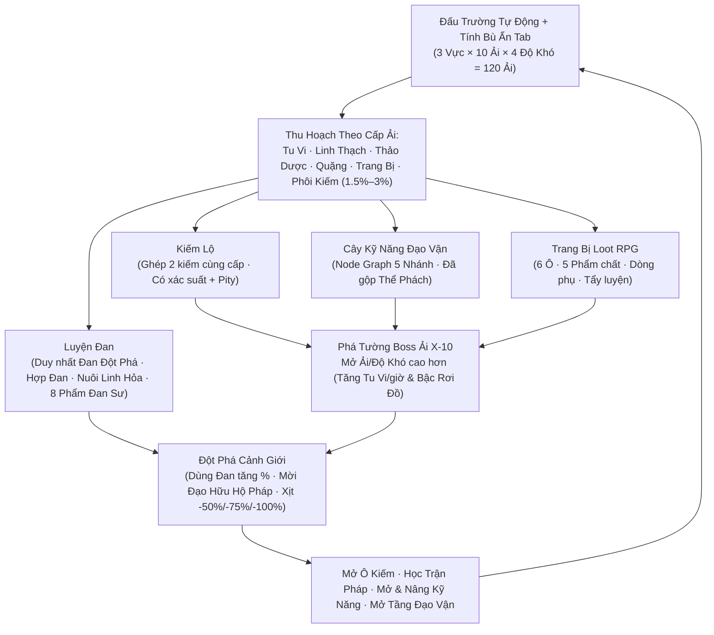

# BÁO CÁO TEST HIỆN TRẠNG & BẢN THIẾT KẾ REMAKE THƯƠNG MẠI (V2 — ĐÃ CHỐT)
> **Dự án:** Khí Vận Chi Tử (Commercial Remake Edition)  
> **Trạng thái thiết kế:** Đã chốt toàn bộ quyết định nền tảng và tích hợp các bản vá cân bằng toán học + UX đa nền tảng.  
> **Phạm vi kiểm tra gốc:** Test trực tiếp Play Mode trên scene [SampleScene_MobileWork.unity](file:///c:/Lap%20trinh%20game/Save%20file/KhiVanChiTu/Assets/Scenes/SampleScene_MobileWork.unity) (Unity `6000.6.4f1`, cô lập hoàn toàn qua `WorkspaceSaveProfile`, save thật `KhiVanChiTu_SaveData.json` giữ nguyên 100%).

---

## PHẦN 1 — TÓM TẮT KIỂM TOÁN HIỆN TRẠNG & CÁC QUYẾT ĐỊNH ĐÃ CHỐT

````carousel

<!-- slide -->

<!-- slide -->

<!-- slide -->

<!-- slide -->

````

### Bảng tổng hợp các quyết định thiết kế đã khóa

| Hạng mục | Quyết định đã chốt |
| :--- | :--- |
| **Quản lý Project** | Dọn dẹp trực tiếp project hiện tại (đã dọn `5,25 GB` rác Đợt 1, tạo khung sạch `Assets/_Game/`). |
| **Công nghệ UI & Mỹ thuật** | **UI Toolkit (`UXML` + `USS` + `Painter2D`)**, **HUD tông SÁNG**, **2 cụm ô tròn đóng/mở**, **100% vị trí ảnh dùng hình render từ Codex** (tuyệt đối không thay bằng icon chữ/emoji). |
| **Bản đồ & Quái vật** | Dựng lại map **đồng cỏ xanh tươi ban ngày** (theo ảnh mẫu), bỏ `Terrain` nặng sang Chunk Mesh nhẹ, xây dựng lại hệ thống Quái & Boss Thủ Lĩnh X-10 Data-Driven. |
| **Đạo Vận & Luyện Thể** | **Gộp 6 chỉ số Luyện Thể thành Nhánh Thể Phách** trong **Cây Kỹ Năng Đạo Vận** (Node Graph kéo/zoom thật). Xóa `UpgradeManager` & `ShopManager` bản đi thi. |
| **Đột Phá & Phạt Tu Vi** | **Phương án A:** Roll % trực tiếp kèm hoạt ảnh Lôi Kiếp (không bắt đánh Boss độ kiếp kép). Thất bại trừ **50% → 75% → 100%** Tu Vi tiểu cảnh hiện tại, có **Trấn Tâm 24h** tự reset chuỗi thất bại. |
| **Nhịp độ & Nền tảng** | **30 ngày treo máy 24/7 (720 giờ)** đạt **Đại Thừa Sơ Kỳ** (tích hợp tính bù thời gian khi ẩn tab Web). Demo Mốc 1 chạy **Local WebGL LAN** trên **iPhone Safari** & **Laptop Browser** kèm bộ đếm FPS + Cài đặt Đồ họa 3D. |

---

## PHẦN 2 — BẢN THIẾT KẾ GAMEPLAY REMAKE CHI TIẾT (ĐÃ HIỆU CHỈNH CÂN BẰNG)

### 2.1 Kiến trúc Vòng Lặp Cốt Lõi (Lấy cảm hứng từ *TBH: Task Bar Hero*)



#### Cấu trúc Chiến Dịch, Sổ Tay Rơi Đồ & Tường Boss (*Task Bar Hero*):
1. **120 Ải Chiến Dịch = 3 Vực × 10 Ải × 4 Độ Khó:**
   - **3 Vực (Acts):** *Vực 1: Đồng Cỏ Thanh Vân* → *Vực 2: Hoang Mạc Nắng Vàng* → *Vực 3: Tiên Sơn Bạch Ngọc* (mỗi vực gồm 9 ải quái thường theo đợt + **Ải X-10 là Boss Thủ Lĩnh**).
   - **4 Cấp Độ Khó:** *Phàm Giới (Thường)* → *Yêu Vực (Ác Mộng)* → *Ma Uyên (Địa Ngục)* → *Tiên Kiếp (Luyện Ngục)*.
2. **Sổ Tay Thấu Thị Rơi Đồ Theo Ải (Stage Loot Preview):**
   - Chạm vào bất kỳ ải nào trên bảng chọn ải sẽ hiển thị rõ: **Danh sách Quái, Tu Vi/phút dự kiến, Bậc Phôi Kiếm rơi (%), Loại Thảo Dược rơi (%), Phẩm chất Trang Bị tối đa**.
   - Người chơi chủ động chọn lùi về ải farm nhanh để gom đúng loại Thảo Dược/Phôi Kiếm đang thiếu, hoặc bật **"Khiêu Chiến Thủ Lĩnh X-10"** khi đủ sức mạnh để sang vùng farm mới.
3. **Tính Bù Thời Gian Khi Ẩn Tab Web & Treo Máy 24/7:**
   - Vì trình duyệt Web tự đóng băng `Update()` khi chuyển tab hoặc khóa màn hình iPhone, hệ thống đo **Năng Suất Thực Chiến (`KillsPerHour`)** tại ải người chơi đang đứng và đối chiếu `UtcNow` để **tính bù chính xác 100% khi ẩn tab ngắn hạn** (và áp hệ số **Bế Quan 75%–90%** khi đóng hẳn game Offline tối đa 12 giờ).

---

### 2.2 Cân Bằng Nhịp Độ 1 Tháng 24/7 (720 Giờ) & Bảo Hiểm Tân Thủ Ngày 1

Mỗi Đại Cảnh Giới gồm **10 Tầng** (*Tầng 1–3 Sơ Kỳ*, *Tầng 4–6 Trung Kỳ*, *Tầng 7–9 Hậu Kỳ*, *Tầng 10 Đỉnh Phong — Bình Cảnh*). Riêng Tầng 10 chiếm **18%–20%** tổng lượng Tu Vi của Đại Cảnh Giới đó:

| Đại Cảnh Giới | Thời gian 24/7 dự kiến | Mốc tích lũy | Ô Kiếm | Độ Khó & Bậc Phôi Kiếm Rơi | Tỷ lệ Đột Phá gốc (chưa Đan) |
| :--- | :---: | :---: | :---: | :--- | :---: |
| **1. Luyện Khí (1 → 10)** | **4 giờ** | Ngày 0.17 | 1 Kiếm | Phàm Giới 1-1 → 1-10 *(Rơi Phôi Lv.1)* | **45%** *(Bảo hiểm tân thủ: có Đan đạt 85%–90%)* |
| **2. Trúc Cơ (1 → 10)** | **20 giờ** | **Hết Ngày 1** | 2 Kiếm | Phàm Giới 2-1 → 2-10 *(Rơi Phôi Lv.1–2)* | **32%** |
| **3. Kim Đan (1 → 10)** | **48 giờ** (2 ngày) | **Ngày 3** | 3 Kiếm | Phàm Giới 3-1 → 3-10 *(Rơi Phôi Lv.1–2)* | **25%** |
| **4. Nguyên Anh (1 → 10)** | **96 giờ** (4 ngày) | **Ngày 7 (Tuần 1)** | 4 Kiếm | Yêu Vực 1-1 → 2-5 *(Rơi Phôi Lv.2–3)* | **20%** |
| **5. Hóa Thần (1 → 10)** | **144 giờ** (6 ngày) | **Ngày 13 (Tuần 2)** | 5 Kiếm | Yêu Vực 2-6 → 3-10 *(Rơi Phôi Lv.2–3)* | **15%** |
| **6. Luyện Hư (1 → 10)** | **180 giờ** (7.5 ngày) | **Ngày 20.5 (Tuần 3)** | 6 Kiếm | Ma Uyên 1-1 → 2-5 *(Rơi Phôi Lv.3–4)* | **12%** |
| **7. Hợp Thể (1 → 10 → Đại Thừa)** | **228 giờ** (9.5 ngày) | **Ngày 30.0 (720h)** | 7 → **8 Kiếm** | Ma Uyên 2-6 → 3-10 *(Rơi Phôi Lv.3–4)* | **8%** |
| **8–9. Đại Thừa → Độ Kiếp** | *30–45 ngày tiếp* | Tháng 2+ | 8 → 10 Kiếm | Tiên Kiếp 1-1 → 3-10 *(Rơi Phôi Lv.4–5)* | **5%** |

> [!NOTE]
> **Chống nản ngày đầu (D1 Retention Guard):** Giữ nguyên luật phạt **-50% / -75% / -100%** ở mọi cảnh giới, nhưng tại mốc vượt đại cảnh giới đầu tiên (**Luyện Khí 10 → Trúc Cơ**), tỷ lệ gốc để `45%`, kết hợp nhiệm vụ tân thủ hướng dẫn nấu/hợp thành **Trúc Cơ Đan Trung/Thượng Phẩm** nâng tổng xác suất lên **85%–90%**. Từ Kim Đan trở đi độ khó siết chặt dần đúng chất tu tiên khắc nghiệt.

---

### 2.3 Lộ Trình Mở Khóa Tính Năng Dần Dần (Progressive Feature Unlocks)

| Mốc Tiến Trình | Thời điểm dự kiến | Tính năng mở khóa | Trải nghiệm & Hướng dẫn cho người chơi |
| :--- | :---: | :--- | :--- |
| **Luyện Khí Tầng 1** | Phút 0 | **Đấu Trường + Kiếm Lộ + Nhiệm Vụ Chính Tuyến** | Chỉ dẫn 2 nhịp trực quan: xem phi kiếm diệt 5 yêu thú → nhặt phôi kiếm đảm bảo → mở ô tròn Kiếm Lộ → ghép kiếm Lv.2 (100% thành công ở bước dạy chơi). |
| **Luyện Khí Tầng 4** | ~20–30 phút | **Cây Kỹ Năng Đạo Vận** + **Kỹ Năng #1 (Lôi Phạt)** | Cộng điểm đầu tiên vào node gốc *Đạo Tâm*; mở ô tròn kỹ năng đầu tiên để tung chiêu đánh Boss ải `1-10`. |
| **Luyện Khí Tầng 7** | ~1,5–2 giờ | **Luyện Đan** (Đan Sư Nhất Phẩm + Phàm Hỏa) | Mở Lò Luyện Đan (duy nhất Đan Đột Phá); thu thập thảo dược nấu & hợp thành **Trúc Cơ Đan**. |
| **Trúc Cơ Sơ Kỳ** | ~4 giờ (Ngày 1) | **Trang Bị Loot RPG (4 ô đầu)** + **Trận Pháp #1 (Lôi Trận)** + **Kỹ Năng #2 (Âm Dương)** + **Ô Kiếm #2** | Săn trang bị có phẩm chất & dòng phụ từ quái/Boss; học Lôi Trận quét quái; mở chuyển đổi **Kiếm Pháp** (*Kiếm Xuyên / Phá Giáp*). |
| **Kim Đan Sơ Kỳ** | Cuối Ngày 1 – Ngày 2 | **Trận Pháp #2 (Cực Hàn Băng Trận)** + **Kỹ Năng #3 (Vạn Kiếm Quy Tông)** + **Ô Trang Bị #5 (Hộ Uyển) & Tẩy Luyện** + **Ô Kiếm #3** | Mở bộ lọc tự rã trang bị rác; dùng Quặng tẩy luyện dòng phụ; phối hợp Vạn Kiếm + Băng Trận phá Boss `3-10`. |
| **Nguyên Anh Sơ Kỳ** | Ngày 3 | **Trận Pháp #3 (Bát Quái Tụ Linh)** + **Ô Trang Bị #6 (Trữ Vật Giới)** + **Độ Khó Yêu Vực** + **Mời Đạo Hữu Hộ Pháp (Online)** + **Ô Kiếm #4** | Bước vào mid-game: săn đồ Tím/Cam có Set Bonus, nâng Thanh Liên Hỏa trong Lò Đan, tương tác Hộ Pháp trên kênh Chat. |
| **Hóa Thần Sơ Kỳ** | Ngày 7 (Tuần 1) | **Trận Pháp #4 (Huyết Ma Hóa Sinh)** + **Kỹ Năng #4 (Ấn Chưởng)** + **Ô Trận Phụ #2** + **Ô Kiếm #5** | Đủ 4 Kỹ Năng chiến đấu + ghép cặp Trận Chính & Trận Phụ (50% hiệu lực) để treo 24/7 ổn định ở Yêu Vực. |
| **Luyện Hư Sơ Kỳ** | Ngày 13 (Tuần 2) | **Trận Pháp #5 (Vạn Kiếm Quy Tông Trận)** + **Độ Khó Ma Uyên** + **Ô Kiếm #6** | Săn Phôi Kiếm Lv.3–4 trực tiếp từ quái Ma Uyên, luyện Đan Sư Lục Phẩm & Tử Cực Hỏa. |
| **Hợp Thể Sơ Kỳ** | Ngày 20 (Tuần 3) | **Trận Pháp #6 (Huyền Vũ Kim Cang Trận)** + **Ô Kiếm #7** | Đủ trọn bộ **6 Đại Trận Pháp**; chuẩn bị Đại Thừa Đan Thượng/Cực Phẩm cho đại kiếp cuối tháng. |
| **Đại Thừa Sơ Kỳ** | Ngày 30 (720h) | **Độ Khó Tiên Kiếp** + **Ô Kiếm #8** + **Vinh danh Thiên Kiêu Bảng** | Đạt mục tiêu lớn tháng đầu; mở thử thách Endgame lên Độ Kiếp (9–10 Kiếm). |

---

### 2.4 Đặc Tả Chi Tiết Từng Hệ Thống Sau Khi Hiệu Chỉnh

#### 1. HUD Tông Sáng 2 Cụm Ô Tròn & Chế Độ Taskbar Mini-Mode
- **Tách 2 cụm ô tròn đóng/mở độc lập (chống chật màn hình dọc, giữ chuẩn nút bấm `56px`):**
  1. **Cụm Tu Luyện (`☯` — Góc dưới-phải):** Nhấn nút tròn Bát Quái sẽ xòe gọn **6 ô tròn cốt lõi** (2 hàng × 3 ô hoặc cánh cung gọn, chỉ hiện tính năng đã mở + 1 ô khóa kế tiếp): `Kiếm Lộ`, `Đạo Vận`, `Luyện Đan`, `Trang Bị`, `Trận Pháp`, `Kỹ Năng`. Thu lại chỉ còn **1 nút tròn `☯` duy nhất**.
  2. **Cụm Hệ Thống & Xã Hội (`≡` — Góc trên-phải):** Sổ dọc xuống các ô tròn tiện ích ít bấm hơn: `Bảng Xếp Hạng`, `Đạo Hữu / Bạn Bè`, `Thành Tựu`, `Cài Đặt Đồ Họa & Âm Thanh` (bên cạnh pill **FPS** và nút **Tĩnh Tọa AFK**).
  3. **Bong bóng Chat Thế Giới (Cạnh trái):** 1 ô tròn nhỏ kèm dải mờ 1 dòng tin nhắn/thông báo nổ Đan Cực Phẩm mới nhất; chạm vào mới bung ngăn Chat & Nhắn Tin Riêng.
- **3 Chế độ khung hình tự động trên UI Toolkit:**
  - **Mobile Dọc (`9:16`):** Toàn màn hình tuân thủ Safe Area tai thỏ/thanh vuốt iPhone.
  - **Web Laptop Ngang (`16:9`):** Khung đấu trường rộng thoáng, không méo tỷ lệ, có thể ghim cố định khung Chat/BXH nhỏ gọn ở mép.
  - **Taskbar Mini-Mode (Khi kéo nhỏ cửa sổ trình duyệt PC `< 480px`):** Tự ẩn toàn bộ rìa phụ, chỉ hiển thị nhân vật chém quái trên nền cỏ xanh + thanh mảnh `% Tu Vi` + `FPS` + chấm chuông báo khi đạt 100% Đỉnh Phong hoặc đầy túi!

#### 2. Hướng Dẫn Tân Thủ 2 Nhịp & Nhiệm Vụ Chính Tuyến Tự Điều Hướng
- **Quy tắc chống lỗi ẩn mũi tên (sửa triệt để lỗi bản cũ):** Nếu mục tiêu nằm trong một ô tròn đang đóng, bước 1 của mũi tên **bắt buộc trỏ vào nút mở cụm `☯` → trỏ vào ô tròn tính năng → sau khi bảng mở ra mới trỏ vào nút hành động bên trong**.
- **Thẻ Nhiệm Vụ Chính Tuyến 1 dòng trên HUD:** Chạm vào thẻ tự mở đúng màn hình cần làm; chạm lần nữa khi hoàn thành là **nhận thưởng tức thì** (không bật popup chắn màn hình).

#### 3. Cây Kỹ Năng Đạo Vận (Interactive Node Graph — Đã gộp Thể Phách)
- Bản đồ **Node Graph thật** (kéo Pan 2 chiều + Zoom + vẽ đường linh mạch phát sáng bằng `Painter2D`), tỏa từ node trung tâm **Đạo Tâm** ra **5 nhánh rõ rệt**:
  1. **Kiếm Đạo:** Sát thương kiếm, Bạo kích, Tốc bay, Sát thương Boss, Chúc phúc ghép kiếm.
  2. **Thể Phách *(gộp trọn 6 chỉ số Luyện Thể cũ)*:** Khí Huyết (HP), Cương Khí (Giảm thương), Dũ Hợp (Hồi HP/s), Kình Lực (Công gốc), Phệ Huyết (Hút máu), Định Tâm (Kháng khống chế) + các node **Nội Tại Bá Thể** ở cuối nhánh!
  3. **Tu Luyện:** +% Tu Vi quái/Boss, +% hiệu suất Bế Quan Offline, giảm thời gian Trấn Tâm.
  4. **Tài Lộc:** +% Linh Thạch, +% phẩm chất Trang Bị rơi, +% Quặng.
  5. **Bách Nghệ:** +% Thảo Dược rơi, tốc độ nấu đan, +% nhẹ tỉ lệ thành công Luyện Đan, giảm hồi chiêu Trận Pháp.
- **Kinh tế nâng cấp 2 tầng:** Các Node Nhỏ tăng chỉ số tốn **Linh Thạch** (sink chính chống lạm phát tiền); các Node Lớn mở nhánh / Nội tại đột phá tốn **Điểm Đạo Vận** (nhận khi thăng cảnh giới & phá Boss ải X-10).

#### 4. Kiếm Lộ — Chuẩn Hóa Ghép `2 Thanh Cùng Cấp` + Xác Suất & Pity
- **Đã sửa lỗi toán học 86.400 phôi:** Mọi cấp ghép từ Lv.1 → Lv.10 đều thống nhất dùng **`1 Kiếm Gốc + 1 Kiếm Phụ cùng cấp` (`2 thanh`)** ($2^9 = 512$ phôi gốc; tính cả hao hụt xác suất + Pity chỉ cần **~1.600–2.000 phôi quy đổi** cho 1 thanh Lv.10, đồng thời quái độ khó cao rơi thẳng Phôi Lv.2–5!).
- **Tỉ lệ rơi từ quái:** Quái thường **1,5% – 3%**, Boss Ải X-10 chắc chắn rơi **1–2 phôi** theo bậc độ khó.

| Cấp ghép (`2 thanh cùng cấp`) | Tỷ lệ thành công gốc | Khi thất bại | Điểm Chúc Phúc (Pity) cộng thêm mỗi lần xịt |
| :---: | :---: | :--- | :---: |
| Lv.1 → Lv.2 | **95%** *(100% bước tutorial)* | Mất 1 Kiếm Phụ + LT, **giữ nguyên Kiếm Gốc** | +15% |
| Lv.2 → Lv.3 | **85%** | Mất 1 Kiếm Phụ + LT, giữ nguyên Kiếm Gốc | +12% |
| Lv.3 → Lv.4 | **75%** | Mất 1 Kiếm Phụ + LT, giữ nguyên Kiếm Gốc | +10% |
| Lv.4 → Lv.5 | **65%** | Mất 1 Kiếm Phụ + LT, giữ nguyên Kiếm Gốc | +8% |
| Lv.5 → Lv.6 | **55%** | Mất 1 Kiếm Phụ + LT, giữ nguyên Kiếm Gốc | +7% |
| Lv.6 → Lv.7 | **45%** | Mất 1 Kiếm Phụ + LT, giữ nguyên Kiếm Gốc | +6% |
| Lv.7 → Lv.8 | **35%** | Mất 1 Kiếm Phụ + LT, giữ nguyên Kiếm Gốc | +5% |
| Lv.8 → Lv.9 | **25%** | Mất 1 Kiếm Phụ + LT, giữ nguyên Kiếm Gốc | +5% |
| Lv.9 → Lv.10 | **15%** | Mất 1 Kiếm Phụ + LT, giữ nguyên Kiếm Gốc | +4% *(dùng thêm Phù Rèn +10%)* |

#### 5. Luyện Đan — Duy Nhất Đan Đột Phá + 8 Phẩm Đan Sư + Hợp Đan & Nuôi Linh Hỏa
- **Chỉ luyện duy nhất 8 Bậc Đan Đột Phá:** *Trúc Cơ Đan (B1) → Kết Kim Đan (B2) → Ngưng Anh Đan (B3) → Hóa Thần Đan (B4) → Luyện Hư Đan (B5) → Hợp Thể Đan (B6) → Đại Thừa Đan (B7) → Độ Kiếp Tiên Đan (B8)*.
- **Cảnh Giới Đan Sư riêng (Nhất Phẩm → Bát Phẩm Đan Sư):**
  - Tỷ lệ luyện thành công ở cùng bậc ($\Delta = \text{Phẩm Đan Sư} - \text{Bậc Đan} = 0$) giảm dần theo độ cao của đan: **B1 `75%` → B2 `65%` → B3 `55%` → B4 `45%` → B5 `38%` → B6 `32%` → B7 `25%` → B8 `18%`**.
  - Luyện vượt bậc ($\Delta < 0$): phạt **$-25\%$ mỗi bậc lệch**. Đan Sư cao hơn bậc đan ($\Delta > 0$): thưởng **$+12\%$ mỗi bậc vượt** và tăng mạnh tỉ lệ nổ **Thượng Phẩm / Cực Phẩm (Đan Văn)**.
- **Vòng tuần hoàn tiêu thụ Đan hoàn chỉnh (giải quyết triệt để bài toán cày XP Đan Sư):**
  1. **Hợp Đan (Tinh Luyện):** Gom **`3 viên Hạ Phẩm` cùng bậc + Dược Trần → tinh luyện thành `1 viên Trung Phẩm`** (và `3 Trung Phẩm → 1 Thượng Phẩm`; riêng **Cực Phẩm / Đan Văn** chỉ có thể nổ trực tiếp từ lò luyện để giữ trọn cảm giác "nổ hũ"!). Mỗi lần Hợp Đan đều nhận thêm **Đan Đạo XP**.
  2. **Tế Đan Nuôi Linh Hỏa:** Mọi viên *Phế Đan* hoặc *Đan Đột Phá của cảnh giới cũ đã vượt qua* đều có thể ném vào lò để nuôi **4 Bậc Linh Hỏa** (*Phàm Hỏa → Thanh Liên Hỏa → Tử Cực Hỏa → Tiên Thiên Hỏa*), vừa nhận **Đan Đạo XP**, vừa giảm vĩnh viễn **10%–35% thời gian nấu đan**!
- **Giá trị cộng xác suất Đột Phá theo Phẩm Đan:**
  - *Hạ Phẩm:* **+15%** | *Trung Phẩm:* **+28%** | *Thượng Phẩm:* **+42%** *(giảm 5% phản phệ)* | *Cực Phẩm (Đan Văn):* **+60%** *(giảm 10% phản phệ + phát thông báo kênh Chat Thế Giới)*.

#### 6. Đột Phá Cảnh Giới, Phạt Cộng Dồn (-50%/-75%/-100%), Trấn Tâm & Hộ Pháp Online
- **Công thức tổng minh bạch trên UI:**
  $$P_{\text{đột phá}} = P_{\text{gốc cảnh giới}} + P_{\text{phẩm đan}} + P_{\text{Đạo Vận}} + P_{\text{Hộ Pháp Online (0\%..+3\%)}}$$
- **Mời Đạo Hữu Hộ Pháp (Khi kết nối Online / LAN):** Từ Nguyên Anh trở lên, trước khi bấm Đột Phá có thể phát lời mời 60s lên Chat Thế Giới; tối đa 3 người chơi khác bấm *"Trợ Uy"* cộng thêm **+1%/người (tối đa +3%)**.
- **Hình phạt thất bại liên tiếp:**
  - Lần 1: **-50%** tổng Tu Vi của Tầng 10 hiện tại (*Tâm Ma Tầng 1*).
  - Lần 2 liên tiếp: **-75%** tổng Tu Vi của Tầng 10 hiện tại (*Tâm Ma Tầng 2*).
  - Lần 3+ liên tiếp: **-100%** Tu Vi Tầng 10 hiện tại (về `0%` Tầng 10, không rớt xuống Tầng 9).
  - **Reset chuỗi phạt về `0`:** Khi đột phá thành công **hoặc** sau **24 giờ Trấn Tâm** (hoặc dùng *Tĩnh Tâm Hương* hiếm từ Nhiệm Vụ Tuần).

#### 7. Sáu Đại Trận Pháp, Trang Bị Loot RPG & Bốn Kỹ Năng Nâng Cấp Dần
- **Giữ nguyên 6 Đại Trận Pháp**, mở khóa rải đều theo Cảnh Giới: ① *Cửu Thiên Lôi Trận* (**Trúc Cơ 1**) → ② *Cực Hàn Băng Trận* (**Kim Đan 1**) → ③ *Bát Quái Tụ Linh Trận* (**Nguyên Anh 1**) → ④ *Huyết Ma Hóa Sinh Trận* (**Hóa Thần 1**, mở kèm Ô Trận Phụ #2 hưởng 50% hiệu lực) → ⑤ *Vạn Kiếm Quy Tông Trận* (**Luyện Hư 1**) → ⑥ *Huyền Vũ Kim Cang Trận* (**Hợp Thể 1**).
- **Trang Bị Loot RPG (6 Ô):** Mở từ **Trúc Cơ Sơ Kỳ** (*Áo, Mũ, Giày, Ngọc Bội*, thêm *Hộ Uyển* ở Kim Đan & *Trữ Vật Giới* ở Nguyên Anh). Rơi từ quái/Boss/rương theo 5 phẩm chất (*Phàm → Linh → Huyền → Địa → Thiên*), có 1–4 dòng phụ ngẫu nhiên, 3 Bộ Set (*Thanh Vân, Huyền Vũ, Đan Tông*), **Cường hóa gắn theo Ô** (đổi đồ mới không mất cấp cường hóa) và **Tẩy Luyện dòng phụ** bằng Quặng + Đá Tẩy Luyện, kèm tự động rã đồ phẩm thấp.
- **4 Kỹ Năng Chiến Đấu mở theo Cảnh Giới & nâng cấp dần:** ① *Lôi Phạt* (**Luyện Khí 4**) → ② *Âm Dương Trận* (**Trúc Cơ 1**) → ③ *Vạn Kiếm Quy Tông* (**Kim Đan 1**) → ④ *Ấn Chưởng* (**Hóa Thần 1**). Sát thương tính theo **% Tổng Công Lực Kiếm**, nâng cấp bằng **Linh Thạch + Tàn Quyển Công Pháp** với hiệu ứng thức tỉnh tại mốc Lv.10 / Lv.20 / Lv.30 và nút bật/tắt `Auto` riêng từng chiêu.

---

## PHẦN 3 — TÍNH NĂNG ONLINE, LỘ TRÌNH 30 NGÀY & PHÁT HÀNH ĐA NỀN TẢNG (1.000 CCU)

1. **Gắn kết chặt Gameplay với Tính Năng Online (Nakama Server):**
   - **3 Bảng Xếp Hạng độc lập:** ① *Thiên Kiêu Bảng* (Cảnh Giới & Tốc độ đạt Đại Thừa), ② *Đan Tông Bảng* (Phẩm Đan Sư & Đan Văn), ③ *Trảm Yêu Bảng* (Ải & Độ Khó *Task Bar Hero* cao nhất).
   - **Kênh Thông Báo Thiên Đạo (trên Chat Thế Giới):** Tự động vinh danh toàn máy chủ khi có người luyện nổ **Đan Cực Phẩm (Đan Văn)**, ghép lên **Kiếm Lv.9–10**, mở khóa Độ Khó mới, hoặc **Đột Phá Đại Thừa** — tạo không khí máy chủ nhộn nhịp đúng chất *Bát Hoang Lục* và *Cổ Tiên Lộ*.
   - **Đạo Hữu (Bạn Bè), Nhắn Tin Riêng & Hộ Pháp:** Kết bạn, chat riêng lưu lịch sử, mỗi ngày **Truyền Công** cho tối đa 5 đạo hữu (`+5%` tốc độ Tu Vi trong 2h) và bấm **Trợ Uy Hộ Pháp** (`+1%`/người, tối đa `+3%`) khi đạo hữu độ kiếp trên Chat Thế Giới.
2. **Giữ nhịp hứng thú suốt 720 giờ:**
   - **Nhật Ký Tiên Lộ 30 Ngày:** Thanh lộ trình mốc lớn (Ngày 1 Trúc Cơ → Tuần 1 Nguyên Anh → Tuần 2 Hóa Thần → Tuần 3 Luyện Hư → Ngày 30 Đại Thừa) thưởng Điểm Đạo Vận & Tĩnh Tâm Hương.
3. **Mô hình Phát Hành Thương Mại & Hạ Tầng 1.000 CCU (Tham khảo *Bát Hoang Lục* & *Cổ Tiên Lộ*):**
   - **Web PC & Mobile Browser:** Bản Unity WebGL tối ưu nhẹ đặt sau Cloudflare CDN (tải lần đầu nhanh, cache cục bộ cho những lần mở sau).
   - **iPhone (Ngoài App Store):** Hỗ trợ song song **Web App PWA (`Add to Home Screen`)** chạy toàn màn hình không thanh địa chỉ trên Safari iOS (0 phí chứng chỉ, không sợ thu hồi) + tùy chọn gói IPA (WebView/Unity iOS) ký qua dịch vụ chứng chỉ doanh nghiệp/TestFlight khi mở rộng.
   - **Android:** Phát hành trực tiếp file **APK nhẹ** tải từ trang chủ (tự kiểm tra phiên bản mới khi mở game).
   - **Hạ tầng 1.000 CCU đồng thời:** Vì chiến đấu chạy phía Client + xác thực/lưu trữ định kỳ (Authoritative Check cho Đột Phá, Ghép Kiếm, Luyện Đan, BXH, Chat WebSocket) qua **Nakama (Go) + PostgreSQL + Cloudflare CDN**, chỉ cần **1 cụm VPS 4–8 vCPU / 8–16 GB RAM NVMe** tại Singapore/Việt Nam (~**\$25–\$45/tháng**) là chịu tải mượt 1.000 người online cùng lúc.
