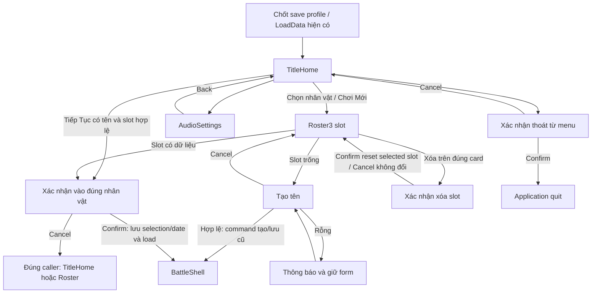
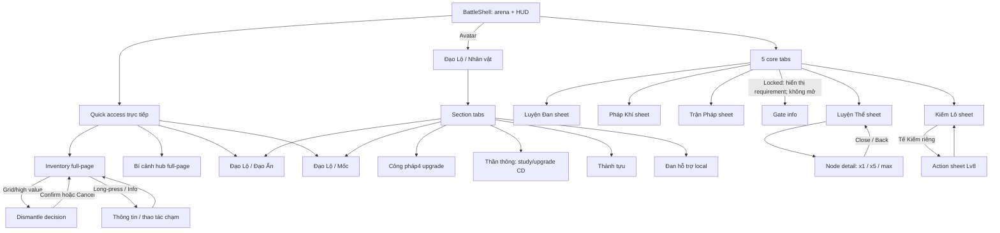
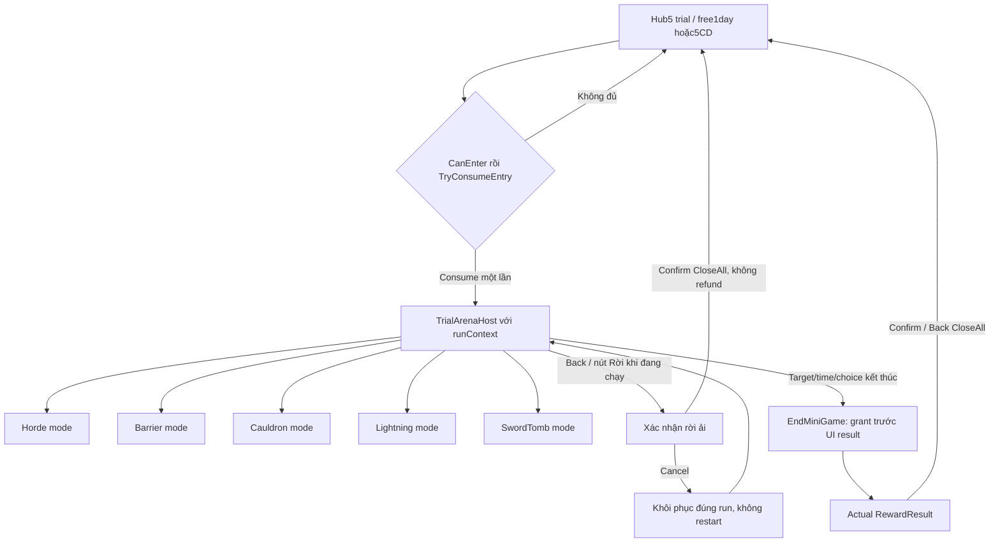
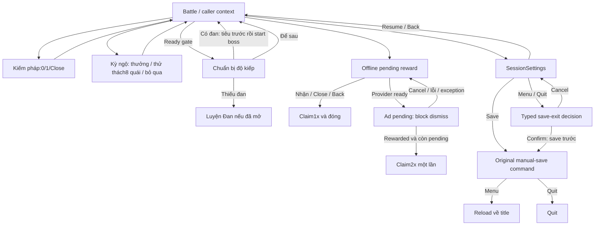
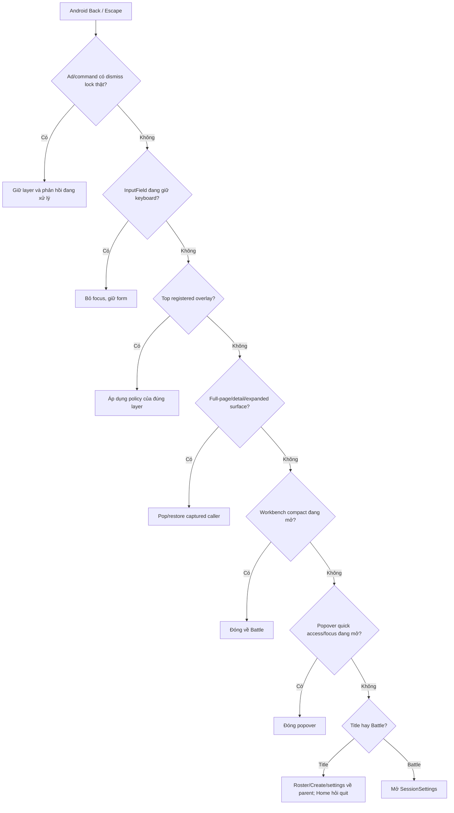

# Phase 02 — Navigation flow

Thiết kế mới dựa trên [Phase01 inventory](feature_inventory.json). [Architecture](new_ui_architecture.md), [component contracts](ui_component_architecture.md) và [map từng FeatureID](screen_redesign_map.json). Chưa thực hiện navigation/layout mới trong Unity.

57 route ID gồm page, modal, host alias, presentation tự động, lifecycle và diagnostics; không phải57 trang đều hiện cho người chơi. Gameplay services và source commands tiếp tục là chuẩn.

## 1. Entry và menu mới

Tiếp Tục là fast path có ngữ cảnh, không auto-enter hoặc bỏ xác nhận. Đổi nhân vật/tạo vào ô khác vẫn qua roster. Keyboard Back bỏ focus trước, lần tiếp theo về roster. Current slot/character ID được capture, không dùng lại selection sau khi đổi list.

## 2. Gameplay và đường truy cập trực tiếp

Các quick action còn truy cập trực tiếp khi workbench mở. Page/section route giữ caller token, không buộc đóng về HUD rồi mở lại. Đổi section thay top section trong cùng hub, không push vô hạn stack. Mốc và Thành tựu giữ dataset/claim action riêng dù dùng cùng PageFrame.

Sheet compact và expanded full-page là hai surface mode của cùng workbench ID và cùng instance/state, không tạo một workbench khác. Đóng expanded quay lại compact; Back tiếp theo đóng sheet. Một tap tab khác chỉ đổi workbench sau khi gate hợp lệ; không làm mất selected item/page/filter của tab cũ.

## 3. Bí cảnh là flow riêng

Alias host và mode không được tiêu lượt hai lần. Leave modal không đóng băng timer hiện có. Nếu run kết thúc khi leave dialog đang mở, hủy context leave cũ và thay bằng result; late confirm không được kết thúc/cấp thưởng lần hai. Rời giữa chừng vẫn là CloseAll và không hoàn entry như source.

Result không mở lại PlayRoot hoặc khởi chạy run khi pop view. Result confirm/back không có lệnh grant. Reward0 là dữ liệu thật, không thay bằng fixture jackpot. Mode-specific targets, ba lần rút kiếm, một lần chọn cauldron, orb/demon identity và cooldown vẫn giữ selector/guard gốc.

## 4. Popup và các quyết định

Menu settings và session settings dùng chung audio panel, khác caller/action set. Resume/settings close không tự đặt timeScale1. Main menu entry/exit và return/quit giữ quyền sở hữu thời gian của controller hiện có. Router không thêm pause khi mở full-page hay overlay.

Không chuyển một action “thiếu tiền” thành lỗi tải route. Service rejection là inline reason/toast và refresh snapshot. RouteError dành cho view/host/binding không dựng được, với Retry view hoặc Return; không tự retry thao tác có side effect.

## 5. Navigation request và return context

AppRouter quản lý:
- RootMode: Title hoặc Gameplay.
- OptionalWorkbench: route ID, compact/expanded, original tab index.
- PageFlow: top page/section, filter/view mode/page/scroll.
- OverlayStack: typed request, caller token, focus anchor, dismiss policy.
- Input owner: top active view đã bind xong.

Mọi OpenPage từ HUD/workbench capture nguyên caller. Back page khôi phục caller state, không gọi OpenDrawer mặc định0 hoặc bỏ filter. Quick jump giữa page root thay top page trong flow và giữ original return context; tab trong Đạo Lộ chỉ thay section. Detail/decision giữ stable subject, không lấy lại item bằng sibling index sau refresh.

Navigation trong lúc transition dùng latest valid request/generation. Layer chưa dựng/bind xong không nhận command. Khi dismiss, hủy animation cũ, hoàn tất state/blocksRaycasts của layer, rồi trả focus; không để phantom backdrop.

## 6. Back, backdrop, swipe và thứ tự ưu tiên

Không suy ra top modal từ tên GameObject hoặc tìm sibling rải rác; mỗi view register input/focus khi active. OverlayCanvas là owner duy nhất; underlying CanvasGroup.interactable=false/blocksRaycasts=false, dimmer bắt raycast. Gameplay simulation vẫn theo clock hiện có.

| Layer/state | Back/close | Backdrop | Swipe |
|---|---|---|---|
| Title enter/delete/quit decision | Cancel đúng caller | Cancel | Không |
| Body detail / item info | Return đúng node/item/caller | Close nếu không executing | Không mặc định |
| Dismantle confirmation | Cancel không chạy delegate | Cancel | Không |
| Workbench compact | Close sheet | Close sheet | Chỉ header/handle |
| Workbench expanded | Về compact cùng state | Không click xuyên full-page | Header gesture nếu có affordance |
| Inventory / progression / hub | Return caller context | Không có dismiss-through | Nội dung scroll, không swipe dismiss page |
| Trial running | Leave decision | Không close qua arena | Không |
| Leave-trial decision | Cancel về run hiện tại | Cancel | Không |
| Trial result | CloseAll về hub | Không tự grant hoặc restart | Không |
| Offline ready | Claim1x rồi close | Không tự vô tình claim qua nền | Không |
| Offline ad pending | Không dismiss | Block | Không |
| Sword style | Close không đổi style | Close | Không |
| Encounter choice | Existing skip/ClosePanel | Chỉ khi policy skip rõ | Không |
| Tribulation | Defer/OnCancelClicked | Defer nếu view có affordance phù hợp | Không |
| Session settings | Close confirmation con trước, rồi resume | Resume nếu không có confirmation/lock | Không |
| RouteError | Return known-safe caller | Không chạy command | Không |

Policy backdrop offline cố ý không coi chạm nền là claim: nguồn chỉ có Close/Back claim1x; không thêm đường grant ngẫu nhiên. Chi tiết Confirm host và source semantics của từng control vẫn lưu trong map.

## 7. Gate, focus và lỗi

Gate được kiểm ở entry lẫn command: feature/realm/sublevel, capacity, parent-level, skill unlock, resources/max, cooldown, active run/session. UI chỉ hiển thị reason, service kiểm lại tại thời điểm command. Các mốc từ source:
- Dock: Kiếm Lô luôn mở; Luyện Đan Luyện Khí7; Trận Pháp Trúc Cơ1; Pháp Khí Nguyên Anh1; Luyện Thể Hóa Thần1.
- Capacity:1–10 theo SwordLoadoutService, gồm Độ Kiếp9/10 theo sublevel.
- Body: realm gate cộng parent-level; old save level>0 được service bảo lưu.
- Dismantle:500 kiếm từ quái; giá trị cao/grid có xác nhận theo source.
- Style: có kiếm>=2, active slot, không có encounter choice.
- Skills: ultimate kiếm>=7; Ấn Chưởng Đại Thừa; Lôi Phạt Nguyên Anh; Âm Dương học>=4 trận; mana/cooldown/ultimate-active guard.
- Trial: daily free hoặc5CD, tiêu trước launch; offline x2 chỉ khi provider ready.

Locked tab vẫn có route thông tin requirement, không unlock hộ người chơi. Disabled command có reason hiển thị/tap-info riêng; không phụ thuộc nhận onClick khi interactable=false. Mất manager/view cần thiết hiển thị lỗi/Thử lại, không tự sửa save hoặc giả thành công.

## 8. Transition specification

| Chuyển | Presentation | Input/focus | Return giữ gì |
|---|---|---|---|
| Open/switch workbench |180–220ms unscaled slide | Block old sheet trong chuyển | tab/page/selection |
| Page root |120–180ms fade/slide ngắn | Target chỉ nhận input sau bind | root/workbench/filter/scroll |
| Detail/decision |120–160ms scale/fade | One top modal; focus first meaningful action | exact caller/subject |
| Close modal |100–140ms unscaled | Block double close; restore previous focus | caller token |
| Trial mode/result |State commit trước view transition | No replay consume/grant | current run/type |
| Route error |Immediate stable panel | Thử lại view / Return | no transaction replay |
| UI at timeScale0/.4/1 |same unscaled transitions | Không chiếm game clock | previous ownership unchanged |

Durations là design defaults cần test, không phải tối ưu đã đo. Ưu tiên focus ổn định hơn animation khi scene/app bị pause/focus change. World VFX, boss phase và minigame timer giữ time source/gameplay hiện có.

## 9. Kiểm chứng flow trước integration

Thiết kế được kiểm route/component tồn tại, mapped route reachable từ root phù hợp, đủ source IDs, không duplicate map, giữ nguyên callback/data/selector gốc trong ledger. Đường diagnostics là development-only; world/lifecycle/value có automatic entry, không đòi nút giả.

Runtime acceptance cần test từng Back/close/backdrop và caller restoration, không chỉ BFS graph. Overlay interruption, timeScale, keyboard, minigame end-during-confirm, ad callback duplicate, save-slot deletion và drag cancellation phải có assertion/ảnh thực tế khi triển khai. Phase02 chưa chạy các test đó.

## 10. Route edge catalogue

Các cạnh replace-section/template-host/host-mode/automatic phục vụ ownership, không phải thêm một lần click hoặc gọi command thứ hai. Cạnh return-context dùng callerState, đích ghi dưới là fallback/expected context; không ép reset về Battle nếu caller là workbench.

| Edge | From | To | Trigger | Kind / guard |
|---|---|---|---|---|
| NAV.001 | title.home | title.characters | choose character / no valid last slot | navigation;  |
| NAV.002 | title.home | confirm.enter-character | continue named last slot | navigation;  |
| NAV.003 | title.home | settings.audio | audio settings | navigation;  |
| NAV.004 | title.home | confirm.quit-title | quit | navigation;  |
| NAV.005 | title.characters | title.create | empty slot | navigation; slotIndex preserved |
| NAV.006 | title.characters | confirm.enter-character | occupied slot | navigation; slotIndex preserved |
| NAV.007 | title.characters | confirm.delete-character | delete occupied slot | navigation;  |
| NAV.008 | title.create | battle.home | valid trimmed name and original create command | navigation;  |
| NAV.009 | title.create | title.characters | cancel after keyboard focus handling | navigation;  |
| NAV.010 | title.characters | title.home | Back | navigation;  |
| NAV.011 | settings.audio | title.home | Back / close | navigation;  |
| NAV.012 | confirm.enter-character | battle.home | confirm original enter command | navigation;  |
| NAV.013 | confirm.enter-character | title.characters | cancel from roster | return-context;  |
| NAV.014 | confirm.enter-character | title.home | cancel from continue shortcut | return-context;  |
| NAV.015 | confirm.delete-character | title.characters | confirm delete only selected slot / cancel | navigation;  |
| NAV.016 | title.home | confirm.context | prepare typed DecisionDialog | template-host; purpose and caller required |
| NAV.017 | title.characters | confirm.context | prepare typed DecisionDialog | template-host; purpose and caller required |
| NAV.018 | settings.session | confirm.context | prepare typed DecisionDialog | template-host; purpose and caller required |
| NAV.019 | battle.home | workbench.sword | dock index 0 | navigation; original FeatureUnlockService gate |
| NAV.020 | workbench.sword | battle.home | toggle same tab / close / backdrop / header swipe | navigation;  |
| NAV.021 | workbench.sword | workbench.body | switch dock tab | navigation; new tab gate; preserve old tab state |
| NAV.022 | workbench.sword | workbench.alchemy | switch dock tab | navigation; new tab gate; preserve old tab state |
| NAV.023 | workbench.sword | workbench.artifact | switch dock tab | navigation; new tab gate; preserve old tab state |
| NAV.024 | workbench.sword | workbench.formation | switch dock tab | navigation; new tab gate; preserve old tab state |
| NAV.025 | workbench.sword | inventory.items | direct quick action | push-page; capture workbench and scroll state |
| NAV.026 | workbench.sword | challenge.hub | direct quick action | push-page; capture workbench and scroll state |
| NAV.027 | workbench.sword | progression.daoan | direct quick action | push-page; capture workbench and scroll state |
| NAV.028 | workbench.sword | progression.milestones | direct quick action | push-page; capture workbench and scroll state |
| NAV.029 | battle.home | workbench.body | dock index 1 | navigation; original FeatureUnlockService gate |
| NAV.030 | workbench.body | battle.home | toggle same tab / close / backdrop / header swipe | navigation;  |
| NAV.031 | workbench.body | workbench.sword | switch dock tab | navigation; new tab gate; preserve old tab state |
| NAV.032 | workbench.body | workbench.alchemy | switch dock tab | navigation; new tab gate; preserve old tab state |
| NAV.033 | workbench.body | workbench.artifact | switch dock tab | navigation; new tab gate; preserve old tab state |
| NAV.034 | workbench.body | workbench.formation | switch dock tab | navigation; new tab gate; preserve old tab state |
| NAV.035 | workbench.body | inventory.items | direct quick action | push-page; capture workbench and scroll state |
| NAV.036 | workbench.body | challenge.hub | direct quick action | push-page; capture workbench and scroll state |
| NAV.037 | workbench.body | progression.daoan | direct quick action | push-page; capture workbench and scroll state |
| NAV.038 | workbench.body | progression.milestones | direct quick action | push-page; capture workbench and scroll state |
| NAV.039 | battle.home | workbench.alchemy | dock index 2 | navigation; original FeatureUnlockService gate |
| NAV.040 | workbench.alchemy | battle.home | toggle same tab / close / backdrop / header swipe | navigation;  |
| NAV.041 | workbench.alchemy | workbench.sword | switch dock tab | navigation; new tab gate; preserve old tab state |
| NAV.042 | workbench.alchemy | workbench.body | switch dock tab | navigation; new tab gate; preserve old tab state |
| NAV.043 | workbench.alchemy | workbench.artifact | switch dock tab | navigation; new tab gate; preserve old tab state |
| NAV.044 | workbench.alchemy | workbench.formation | switch dock tab | navigation; new tab gate; preserve old tab state |
| NAV.045 | workbench.alchemy | inventory.items | direct quick action | push-page; capture workbench and scroll state |
| NAV.046 | workbench.alchemy | challenge.hub | direct quick action | push-page; capture workbench and scroll state |
| NAV.047 | workbench.alchemy | progression.daoan | direct quick action | push-page; capture workbench and scroll state |
| NAV.048 | workbench.alchemy | progression.milestones | direct quick action | push-page; capture workbench and scroll state |
| NAV.049 | battle.home | workbench.artifact | dock index 3 | navigation; original FeatureUnlockService gate |
| NAV.050 | workbench.artifact | battle.home | toggle same tab / close / backdrop / header swipe | navigation;  |
| NAV.051 | workbench.artifact | workbench.sword | switch dock tab | navigation; new tab gate; preserve old tab state |
| NAV.052 | workbench.artifact | workbench.body | switch dock tab | navigation; new tab gate; preserve old tab state |
| NAV.053 | workbench.artifact | workbench.alchemy | switch dock tab | navigation; new tab gate; preserve old tab state |
| NAV.054 | workbench.artifact | workbench.formation | switch dock tab | navigation; new tab gate; preserve old tab state |
| NAV.055 | workbench.artifact | inventory.items | direct quick action | push-page; capture workbench and scroll state |
| NAV.056 | workbench.artifact | challenge.hub | direct quick action | push-page; capture workbench and scroll state |
| NAV.057 | workbench.artifact | progression.daoan | direct quick action | push-page; capture workbench and scroll state |
| NAV.058 | workbench.artifact | progression.milestones | direct quick action | push-page; capture workbench and scroll state |
| NAV.059 | battle.home | workbench.formation | dock index 4 | navigation; original FeatureUnlockService gate |
| NAV.060 | workbench.formation | battle.home | toggle same tab / close / backdrop / header swipe | navigation;  |
| NAV.061 | workbench.formation | workbench.sword | switch dock tab | navigation; new tab gate; preserve old tab state |
| NAV.062 | workbench.formation | workbench.body | switch dock tab | navigation; new tab gate; preserve old tab state |
| NAV.063 | workbench.formation | workbench.alchemy | switch dock tab | navigation; new tab gate; preserve old tab state |
| NAV.064 | workbench.formation | workbench.artifact | switch dock tab | navigation; new tab gate; preserve old tab state |
| NAV.065 | workbench.formation | inventory.items | direct quick action | push-page; capture workbench and scroll state |
| NAV.066 | workbench.formation | challenge.hub | direct quick action | push-page; capture workbench and scroll state |
| NAV.067 | workbench.formation | progression.daoan | direct quick action | push-page; capture workbench and scroll state |
| NAV.068 | workbench.formation | progression.milestones | direct quick action | push-page; capture workbench and scroll state |
| NAV.069 | battle.home | inventory.items | direct quick action | push-page;  |
| NAV.070 | battle.home | challenge.hub | direct quick action | push-page;  |
| NAV.071 | battle.home | progression.daoan | direct quick action | push-page;  |
| NAV.072 | battle.home | progression.milestones | direct quick action | push-page;  |
| NAV.073 | battle.home | progression.character | existing HUD intent / corresponding event | navigation-or-overlay; original gate if applicable |
| NAV.074 | battle.home | battle.shortcuts | existing HUD intent / corresponding event | navigation-or-overlay; original gate if applicable |
| NAV.075 | battle.home | battle.style | existing HUD intent / corresponding event | navigation-or-overlay; original gate if applicable |
| NAV.076 | battle.home | battle.encounter | existing HUD intent / corresponding event | navigation-or-overlay; original gate if applicable |
| NAV.077 | battle.home | modal.tribulation | existing HUD intent / corresponding event | navigation-or-overlay; original gate if applicable |
| NAV.078 | battle.home | modal.offline | existing HUD intent / corresponding event | navigation-or-overlay; original gate if applicable |
| NAV.079 | battle.home | settings.session | existing HUD intent / corresponding event | navigation-or-overlay; original gate if applicable |
| NAV.080 | battle.home | hud.quest | existing HUD intent / corresponding event | navigation-or-overlay; original gate if applicable |
| NAV.081 | battle.home | hud.quest-guide | existing HUD intent / corresponding event | navigation-or-overlay; original gate if applicable |
| NAV.082 | battle.home | hud.tooltip | existing HUD intent / corresponding event | navigation-or-overlay; original gate if applicable |
| NAV.083 | battle.home | hud.combat-log | existing HUD intent / corresponding event | navigation-or-overlay; original gate if applicable |
| NAV.084 | battle.home | battle.world-damage | existing lifecycle/actor event | automatic;  |
| NAV.085 | battle.home | battle.world-overlays | existing lifecycle/actor event | automatic;  |
| NAV.086 | battle.home | system.save | existing lifecycle/actor event | automatic;  |
| NAV.087 | battle.home | system.input | existing lifecycle/actor event | automatic;  |
| NAV.088 | workbench.sword | inventory.items | storage / dismantle shortcut with category context | navigation;  |
| NAV.089 | workbench.sword | inventory.sacrifice-lv8 | secondary sword action | navigation;  |
| NAV.090 | inventory.sacrifice-lv8 | workbench.sword | close / existing sacrifice command result | navigation;  |
| NAV.091 | workbench.body | body.node-detail | select node ID | navigation;  |
| NAV.092 | body.node-detail | workbench.body | close / Back | return-context;  |
| NAV.093 | inventory.items | confirm.dismantle | grid action / high-value compact-list action | overlay; item/reward/delegate captured |
| NAV.094 | confirm.dismantle | inventory.items | confirm existing command once / cancel | return-context;  |
| NAV.095 | inventory.items | inventory.item-info | info / long-press | navigation;  |
| NAV.096 | inventory.item-info | inventory.items | dismiss | return-context;  |
| NAV.097 | progression.character | progression.disciplines | section tab | replace-section; retain per-tab scroll/filter; do not grow page stack |
| NAV.098 | progression.character | progression.skills | section tab | replace-section; retain per-tab scroll/filter; do not grow page stack |
| NAV.099 | progression.character | progression.daoan | section tab | replace-section; retain per-tab scroll/filter; do not grow page stack |
| NAV.100 | progression.character | progression.milestones | section tab | replace-section; retain per-tab scroll/filter; do not grow page stack |
| NAV.101 | progression.character | progression.achievements | section tab | replace-section; retain per-tab scroll/filter; do not grow page stack |
| NAV.102 | progression.character | progression.buff-shop | section tab | replace-section; retain per-tab scroll/filter; do not grow page stack |
| NAV.103 | progression.disciplines | progression.character | section tab | replace-section; retain per-tab scroll/filter; do not grow page stack |
| NAV.104 | progression.disciplines | progression.skills | section tab | replace-section; retain per-tab scroll/filter; do not grow page stack |
| NAV.105 | progression.disciplines | progression.daoan | section tab | replace-section; retain per-tab scroll/filter; do not grow page stack |
| NAV.106 | progression.disciplines | progression.milestones | section tab | replace-section; retain per-tab scroll/filter; do not grow page stack |
| NAV.107 | progression.disciplines | progression.achievements | section tab | replace-section; retain per-tab scroll/filter; do not grow page stack |
| NAV.108 | progression.disciplines | progression.buff-shop | section tab | replace-section; retain per-tab scroll/filter; do not grow page stack |
| NAV.109 | progression.skills | progression.character | section tab | replace-section; retain per-tab scroll/filter; do not grow page stack |
| NAV.110 | progression.skills | progression.disciplines | section tab | replace-section; retain per-tab scroll/filter; do not grow page stack |
| NAV.111 | progression.skills | progression.daoan | section tab | replace-section; retain per-tab scroll/filter; do not grow page stack |
| NAV.112 | progression.skills | progression.milestones | section tab | replace-section; retain per-tab scroll/filter; do not grow page stack |
| NAV.113 | progression.skills | progression.achievements | section tab | replace-section; retain per-tab scroll/filter; do not grow page stack |
| NAV.114 | progression.skills | progression.buff-shop | section tab | replace-section; retain per-tab scroll/filter; do not grow page stack |
| NAV.115 | progression.daoan | progression.character | section tab | replace-section; retain per-tab scroll/filter; do not grow page stack |
| NAV.116 | progression.daoan | progression.disciplines | section tab | replace-section; retain per-tab scroll/filter; do not grow page stack |
| NAV.117 | progression.daoan | progression.skills | section tab | replace-section; retain per-tab scroll/filter; do not grow page stack |
| NAV.118 | progression.daoan | progression.milestones | section tab | replace-section; retain per-tab scroll/filter; do not grow page stack |
| NAV.119 | progression.daoan | progression.achievements | section tab | replace-section; retain per-tab scroll/filter; do not grow page stack |
| NAV.120 | progression.daoan | progression.buff-shop | section tab | replace-section; retain per-tab scroll/filter; do not grow page stack |
| NAV.121 | progression.milestones | progression.character | section tab | replace-section; retain per-tab scroll/filter; do not grow page stack |
| NAV.122 | progression.milestones | progression.disciplines | section tab | replace-section; retain per-tab scroll/filter; do not grow page stack |
| NAV.123 | progression.milestones | progression.skills | section tab | replace-section; retain per-tab scroll/filter; do not grow page stack |
| NAV.124 | progression.milestones | progression.daoan | section tab | replace-section; retain per-tab scroll/filter; do not grow page stack |
| NAV.125 | progression.milestones | progression.achievements | section tab | replace-section; retain per-tab scroll/filter; do not grow page stack |
| NAV.126 | progression.milestones | progression.buff-shop | section tab | replace-section; retain per-tab scroll/filter; do not grow page stack |
| NAV.127 | progression.achievements | progression.character | section tab | replace-section; retain per-tab scroll/filter; do not grow page stack |
| NAV.128 | progression.achievements | progression.disciplines | section tab | replace-section; retain per-tab scroll/filter; do not grow page stack |
| NAV.129 | progression.achievements | progression.skills | section tab | replace-section; retain per-tab scroll/filter; do not grow page stack |
| NAV.130 | progression.achievements | progression.daoan | section tab | replace-section; retain per-tab scroll/filter; do not grow page stack |
| NAV.131 | progression.achievements | progression.milestones | section tab | replace-section; retain per-tab scroll/filter; do not grow page stack |
| NAV.132 | progression.achievements | progression.buff-shop | section tab | replace-section; retain per-tab scroll/filter; do not grow page stack |
| NAV.133 | progression.buff-shop | progression.character | section tab | replace-section; retain per-tab scroll/filter; do not grow page stack |
| NAV.134 | progression.buff-shop | progression.disciplines | section tab | replace-section; retain per-tab scroll/filter; do not grow page stack |
| NAV.135 | progression.buff-shop | progression.skills | section tab | replace-section; retain per-tab scroll/filter; do not grow page stack |
| NAV.136 | progression.buff-shop | progression.daoan | section tab | replace-section; retain per-tab scroll/filter; do not grow page stack |
| NAV.137 | progression.buff-shop | progression.milestones | section tab | replace-section; retain per-tab scroll/filter; do not grow page stack |
| NAV.138 | progression.buff-shop | progression.achievements | section tab | replace-section; retain per-tab scroll/filter; do not grow page stack |
| NAV.139 | inventory.items | battle.home | Back to captured caller | return-context; restore workbench when caller was a workbench instead of root battle |
| NAV.140 | challenge.hub | battle.home | Back to captured caller | return-context; restore workbench when caller was a workbench instead of root battle |
| NAV.141 | progression.character | battle.home | Back to captured caller | return-context; restore workbench when caller was a workbench instead of root battle |
| NAV.142 | progression.disciplines | battle.home | Back to captured caller | return-context; restore workbench when caller was a workbench instead of root battle |
| NAV.143 | progression.skills | battle.home | Back to captured caller | return-context; restore workbench when caller was a workbench instead of root battle |
| NAV.144 | progression.daoan | battle.home | Back to captured caller | return-context; restore workbench when caller was a workbench instead of root battle |
| NAV.145 | progression.milestones | battle.home | Back to captured caller | return-context; restore workbench when caller was a workbench instead of root battle |
| NAV.146 | progression.achievements | battle.home | Back to captured caller | return-context; restore workbench when caller was a workbench instead of root battle |
| NAV.147 | progression.buff-shop | battle.home | Back to captured caller | return-context; restore workbench when caller was a workbench instead of root battle |
| NAV.148 | challenge.hub | challenge.horde | enter trial | navigation; TryConsumeEntry once before launch |
| NAV.149 | challenge.play | challenge.horde | activeType selects mode | host-mode; no second consume/launch |
| NAV.150 | challenge.horde | challenge.result | original run end / reward granted | result;  |
| NAV.151 | challenge.horde | confirm.leave-trial | Back / explicit exit | overlay; running runContext captured |
| NAV.152 | confirm.leave-trial | challenge.horde | cancel | return-context; only return to same live run; never restart |
| NAV.153 | challenge.hub | challenge.barrier | enter trial | navigation; TryConsumeEntry once before launch |
| NAV.154 | challenge.play | challenge.barrier | activeType selects mode | host-mode; no second consume/launch |
| NAV.155 | challenge.barrier | challenge.result | original run end / reward granted | result;  |
| NAV.156 | challenge.barrier | confirm.leave-trial | Back / explicit exit | overlay; running runContext captured |
| NAV.157 | confirm.leave-trial | challenge.barrier | cancel | return-context; only return to same live run; never restart |
| NAV.158 | challenge.hub | challenge.cauldron | enter trial | navigation; TryConsumeEntry once before launch |
| NAV.159 | challenge.play | challenge.cauldron | activeType selects mode | host-mode; no second consume/launch |
| NAV.160 | challenge.cauldron | challenge.result | original run end / reward granted | result;  |
| NAV.161 | challenge.cauldron | confirm.leave-trial | Back / explicit exit | overlay; running runContext captured |
| NAV.162 | confirm.leave-trial | challenge.cauldron | cancel | return-context; only return to same live run; never restart |
| NAV.163 | challenge.hub | challenge.lightning | enter trial | navigation; TryConsumeEntry once before launch |
| NAV.164 | challenge.play | challenge.lightning | activeType selects mode | host-mode; no second consume/launch |
| NAV.165 | challenge.lightning | challenge.result | original run end / reward granted | result;  |
| NAV.166 | challenge.lightning | confirm.leave-trial | Back / explicit exit | overlay; running runContext captured |
| NAV.167 | confirm.leave-trial | challenge.lightning | cancel | return-context; only return to same live run; never restart |
| NAV.168 | challenge.hub | challenge.sword-tomb | enter trial | navigation; TryConsumeEntry once before launch |
| NAV.169 | challenge.play | challenge.sword-tomb | activeType selects mode | host-mode; no second consume/launch |
| NAV.170 | challenge.sword-tomb | challenge.result | original run end / reward granted | result;  |
| NAV.171 | challenge.sword-tomb | confirm.leave-trial | Back / explicit exit | overlay; running runContext captured |
| NAV.172 | confirm.leave-trial | challenge.sword-tomb | cancel | return-context; only return to same live run; never restart |
| NAV.173 | challenge.hub | challenge.play | shared TrialArenaHost | template-host;  |
| NAV.174 | challenge.play | confirm.leave-trial | Back / exit in generic host | navigation;  |
| NAV.175 | challenge.play | challenge.result | end with actual granted result | navigation;  |
| NAV.176 | confirm.leave-trial | challenge.hub | confirm CloseAll | navigation; no refund / no grant |
| NAV.177 | challenge.result | challenge.hub | confirm / Back => CloseAll | navigation;  |
| NAV.178 | battle.style | battle.home | SelectStyle0/1 or ClosePanel | navigation;  |
| NAV.179 | battle.encounter | battle.home | reward / challenge / skip via original commands | navigation;  |
| NAV.180 | modal.tribulation | workbench.alchemy | confirm without suitable pill | navigation; only if Alchemy gate permits; no boss start |
| NAV.181 | modal.tribulation | battle.home | pill consumed then boss start / defer | navigation;  |
| NAV.182 | modal.offline | battle.home | x1 / success x2 / Close Back x1 | navigation; not ad pending; service grant once |
| NAV.183 | settings.session | battle.home | resume / Back | return-context; do not change previous timeScale |
| NAV.184 | settings.session | confirm.return-title | return title | navigation;  |
| NAV.185 | settings.session | confirm.quit-session | quit session | navigation;  |
| NAV.186 | confirm.return-title | title.home | confirm save then scene reload | navigation;  |
| NAV.187 | confirm.return-title | settings.session | cancel | return-context;  |
| NAV.188 | confirm.quit-session | settings.session | cancel | return-context;  |
| NAV.189 | system.input | hud.tooltip | tap/hover info | input;  |
| NAV.190 | battle.home | overlay.route-error | host/binding load failure | error;  |
| NAV.191 | title.home | overlay.route-error | host/binding load failure | error;  |
| NAV.192 | diagnostics.hub | diagnostics.online-preview | fixture preview | development;  |
| NAV.193 | diagnostics.hub | diagnostics.recovery-splash | historical reference | development;  |
| NAV.194 | diagnostics.hub | diagnostics.recovery-cheats | historical reference | development;  |
| NAV.195 | diagnostics.hub | diagnostics.sword-spawn | historical reference | development;  |

### Terminal / context exits

| From | Destination | Existing command / semantics |
|---|---|---|
| confirm.quit-title | APPLICATION_EXIT | existing ConfirmQuitGame |
| confirm.quit-session | APPLICATION_EXIT | existing SyncAndSaveGame then quit |
| confirm.context | CAPTURED_CALLER | cancel/back; no confirm command |
| overlay.route-error | CAPTURED_CALLER | return without transaction replay |

## Xác minh bàn giao Phase 02

- Đủ7.712/7.712 FeatureID,0 trùng/thiếu; callback/data/row hash gốc khớp;48 nhóm nguồn có mapping.
- 57 route và component đích hợp lệ;195 cạnh được kiểm tra, mapped route reachable theo production/development/lifecycle root phù hợp.
- Bốn tài liệu liên kết đúng, Markdown fence cân bằng; GUID/fileID đích còn null có chủ đích vì chưa tạo view.
- Mọi file có trước Phase02 giữ nguyên SHA-256; Assets/Packages/ProjectSettings, AGENTS, tài liệu Phase00/01, HEAD/branch/index không đổi.
- Scene mobile vẫn sạch,12 root; hash save hiện tại giữ nguyên so với đầu Phase02. Không so với save cũ của Phase01 vì người dùng có thể đã chơi giữa hai phase.
- Đây là xác minh coverage/thiết kế và bảo toàn nội dung; chưa triển khai hoặc chứng nhận runtime/thiết bị.
