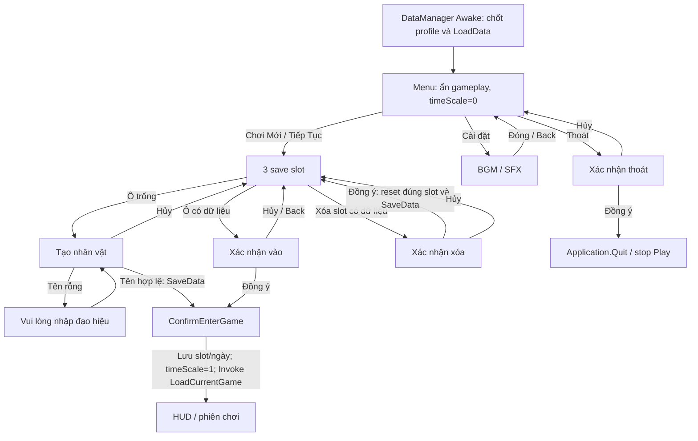
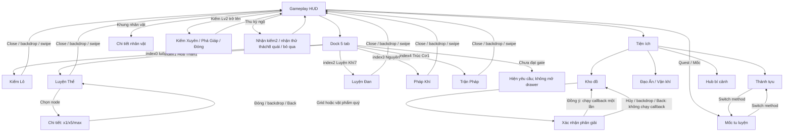
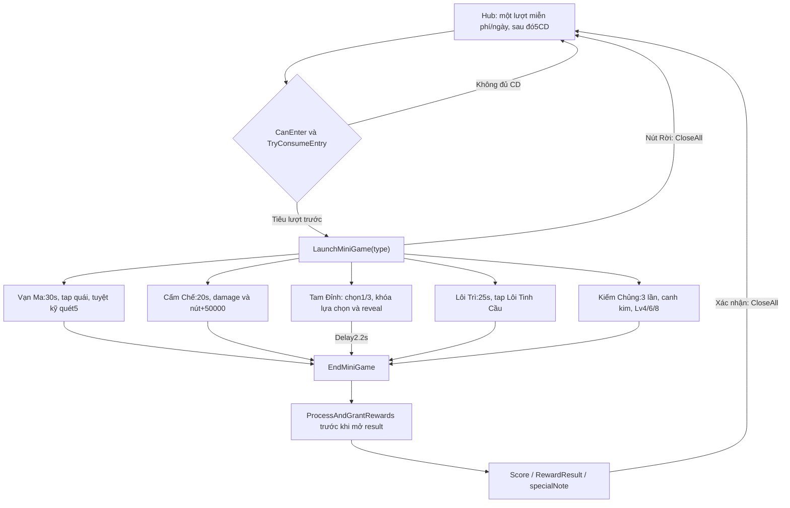
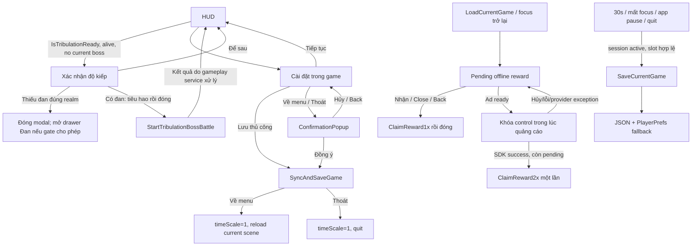
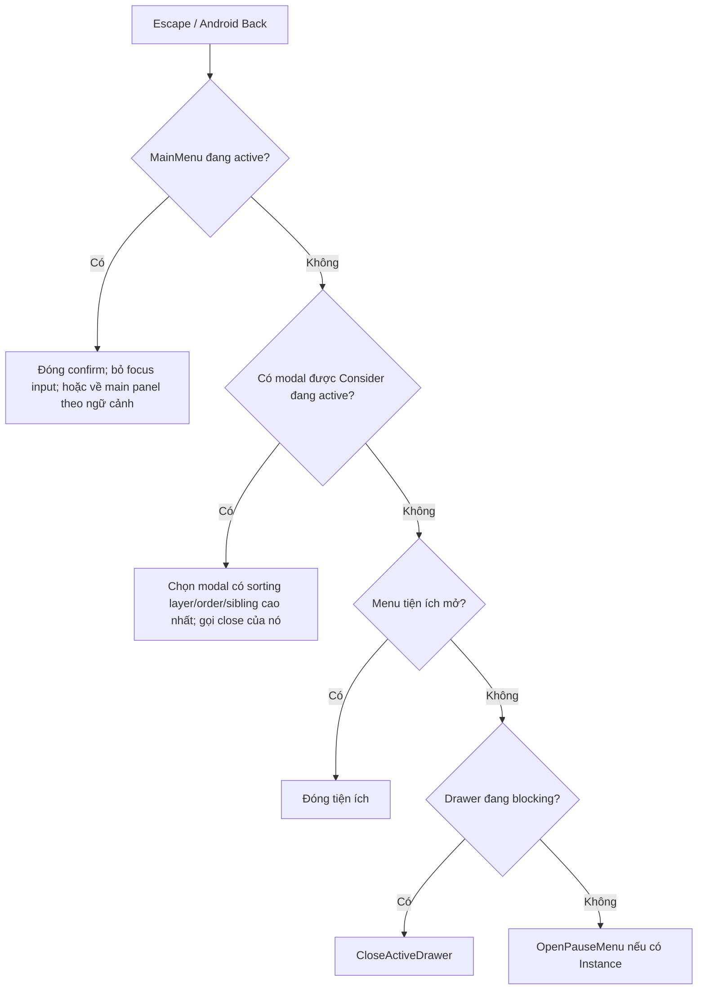

# Phase 01 — Screen Flow Map

Bản đồ này mô tả hành vi **đang có trong source**, không phải đề xuất thiết kế mới. Baseline hiện tại đã có Jade V2. Phase 01 không đổi hierarchy, bố cục, listener, gameplay hoặc save.

Danh tính từng object/control, dữ liệu hiển thị và callback nằm trong [feature_inventory.json](feature_inventory.json). Ma trận 10 cột nằm trong [feature_parity_matrix.md](feature_parity_matrix.md).

## 1. Menu và save slot

Back tại màn tạo nhân vật sẽ bỏ focus InputField trước; lần Back sau mới về chọn nhân vật. Xác nhận menu có delegate theo ngữ cảnh; không dùng chung hành động vào/xóa/thoát một cách mất phân biệt.

## 2. HUD, dock và modal

Các method chuyển mốc/thành tựu có trong source; mức truy cập của từng nút được giữ riêng trong inventory, không giả định mọi method đều có một nút đang hiện. Menu tiện ích tự đóng sau khi mở modal. Các shortcut cũ đang ẩn vẫn có record riêng; không coi chúng đã bị gỡ khỏi yêu cầu bảo toàn.

Dock collapse đóng drawer đang mở và phát OnDockCollapseChanged. GameplayChoicesService dùng sự kiện này để chuyển vị trí nút kiếm pháp. Nút đó bị ẩn khi modal/drawer chặn gameplay, và chỉ cho đổi khi đã mở kiếm pháp và không đang chọn kỳ ngộ.

## 3. Năm mini-game bí cảnh và kết quả

CloseAll dọn arena, ẩn PlayRoot và Result rồi mở lại hub; không có hoàn lượt trong method này. Nút hành động footer đổi callback theo loại mini-game; Tam Đỉnh và Lôi Trì ẩn nút footer. Các nút quái, cauldron, orb và needle states được sinh/wire tại runtime, đã ghi source/factory và selector trong JSON.

Hai khác biệt có sẵn cần kiểm thử sau: mô tả hub nói kiếm5–8 nhưng code chọn4/6/8; ShowResultModal có dữ liệu jackpot minh họa khi một số trường reward bằng0, không đồng nghĩa service cấp thêm reward.

**Back chưa có nhánh riêng cho SecretRealmPlayRoot/SecretRealmResultModal trong MobileUINavigationManager.** Không nối giả Back tới CloseAll trong sơ đồ; đây là khoảng trống đã ghi nhận.

## 4. Độ kiếp, offline, cài đặt và lifecycle

Mở/resume PauseMenuManager không đổi timeScale hiện tại. Chỉ nhánh xác nhận về menu/thoát đặt1 trước reload/quit. MainMenuManager quản lý0/1 khi vào menu/game. Không được hợp nhất các quyền sở hữu thời gian này thành quy tắc mọi modal đều pause hoặc mọi close đều đặt1.

Độ kiếp dùng đan chất lượng cao nhất đúng realm; text bonus và tỷ lệ mất tu vi lấy từ dữ liệu/service. Xác nhận thiếu đan không bắt đầu trận. Đóng offline bằng Close/Back thực chất nhận1x; callback quảng cáo có guard tránh grant lặp. DismantleConfirmModalUI thiếu Instance hiện gọi thẳng confirm callback — hành vi fallback phải được ghi nhận trước khi thay UI.

DataManager chốt WorkspaceSaveProfile trước DontDestroyOnLoad. Production, pc-workspace và jade-ui-qa là các profile khác nhau. Phase 01 chỉ đọc hash production; không thực hiện Save/LoadCurrentGame, tạo/xóa slot, claim, upgrade hay quảng cáo.

## 5. Quy tắc Back chính xác

Danh sách modal được Consider: Đạo Ấn, hub bí cảnh, phân giải, kho, thành tựu, mốc, body detail, character detail, độ kiếp, offline, pause và gameplay choice. Thứ tự chọn dựa trên lớp vẽ/sibling thực tế, không phải thứ tự tên trong danh sách. Pause close ưu tiên confirmation con; offline close có tác dụng claim1x. PlayRoot/Result bí cảnh chưa có nhánh riêng như đã ghi ở trên.

## 6. Legacy và nguồn dữ liệu

RightPanel, ShopPanel và TutorialOverlay bị giữ ẩn trong mobile. Công pháp cũ, thẻ học/nâng skill bằng CD, shop buff, right-click equip/unequip và tooltip hover vẫn có source/serialized record; không tự xóa vì trùng một phần service mobile. Hai route học skill bằng CD và auto unlock có điều kiện khác nhau.

Auth, leaderboard, sync/online status thuộc ViewModel/mock data; không tìm thấy một luồng backend thật để nối trong sơ đồ. Recovery có splash với controller thiếu và hai nút cheat không tìm thấy callback hiện hành; chúng được phân loại lịch sử chưa có hành vi runtime xác lập.

ScriptableObject/config, service guard và save schema đã quét:47 instance ScriptableObject do project định nghĩa (kể cả Readme),40 stage assets,4 upgrade assets, skill asset và DaoAnCatalog. Cấu hình runtime được service tạo/ghi đè vẫn giữ source riêng, không mặc định giá trị asset luôn là giá trị đang chơi.

## 7. Tất cả route có source evidence

| ID | Từ | Đến | Trigger / điều kiện | Method | Panel đóng/giữ |
|---|---|---|---|---|---|
| FLOW.001 | Menu chính | Chọn nhân vật (3 slot) | play / continue;  | Assets/Scripts/UI/MainMenuManager.cs:228 OpenCharacterSelection |  |
| FLOW.002 | Chọn nhân vật (3 slot) | Tạo nhân vật | click empty slot; slot.isSlotEmpty | Assets/Scripts/UI/MainMenuManager.cs:240 OpenCharacterCreation |  |
| FLOW.003 | Chọn nhân vật (3 slot) | Xác nhận ở menu | click occupied slot / delete;  | Assets/Scripts/UI/MainMenuManager.cs:350 ShowConfirmation |  |
| FLOW.004 | Tạo nhân vật | HUD nhân vật và chiến đấu | confirm valid trimmed name; non-empty name | Assets/Scripts/UI/MainMenuManager.cs:248 OnConfirmCreateCharacter | SaveData then ConfirmEnterGame; hides MainMenu and restores gameplay |
| FLOW.005 | Tạo nhân vật | Chọn nhân vật (3 slot) | cancel;  | Assets/Scripts/UI/MainMenuManager.cs:177 SetupButtons |  |
| FLOW.006 | Menu chính | Cài đặt từ menu | settings;  | Assets/Scripts/UI/MainMenuManager.cs:177 SetupButtons |  |
| FLOW.007 | Cài đặt từ menu | Menu chính | close settings / Back;  | Assets/Scripts/UI/MainMenuManager.cs:78 HandleBackNavigation |  |
| FLOW.008 | Xác nhận ở menu | HUD nhân vật và chiến đấu | confirm enter; selected occupied slot | Assets/Scripts/UI/MainMenuManager.cs:304 ConfirmEnterGame | save selection/date; timeScale=1; deferred LoadCurrentGame |
| FLOW.009 | Xác nhận ở menu | Chọn nhân vật (3 slot) | confirm delete; delete confirmation | Assets/Scripts/UI/MainMenuManager.cs:278 AskConfirmDeleteSlot | reset only selected slot; SaveData; refresh list |
| FLOW.010 | Xác nhận ở menu | APPLICATION_EXIT | confirm quit; context dependent | Assets/Scripts/UI/MainMenuManager.cs:336 ConfirmQuitGame | Application.Quit / stop Editor Play; cancel hides confirmation and retains caller |
| FLOW.011 | Dock 5 tab và drawer shell | Kiếm Lô, trang bị, phân trang | tab toggle / switch; IsDrawerUnlocked(index) | Assets/Scripts/UI/MobileDrawerUIController.cs:323 OpenDrawer | previous drawer closed |
| FLOW.012 | Dock 5 tab và drawer shell | Cây luyện thể (6 node) | tab toggle / switch; IsDrawerUnlocked(index) | Assets/Scripts/UI/MobileDrawerUIController.cs:323 OpenDrawer | previous drawer closed |
| FLOW.013 | Dock 5 tab và drawer shell | Luyện đan, lò và kho đan | tab toggle / switch; IsDrawerUnlocked(index) | Assets/Scripts/UI/MobileDrawerUIController.cs:323 OpenDrawer | previous drawer closed |
| FLOW.014 | Dock 5 tab và drawer shell | Pháp khí (4 slot) | tab toggle / switch; IsDrawerUnlocked(index) | Assets/Scripts/UI/MobileDrawerUIController.cs:323 OpenDrawer | previous drawer closed |
| FLOW.015 | Dock 5 tab và drawer shell | Trận pháp (6 trận) | tab toggle / switch; IsDrawerUnlocked(index) | Assets/Scripts/UI/MobileDrawerUIController.cs:323 OpenDrawer | previous drawer closed |
| FLOW.016 | Dock 5 tab và drawer shell | HUD nhân vật và chiến đấu | close / backdrop / swipe;  | Assets/Scripts/UI/MobileDrawerUIController.cs:363 CloseActiveDrawer |  |
| FLOW.017 | Dock 5 tab và drawer shell | HUD nhân vật và chiến đấu | collapse dock; unscaled animation | Assets/Scripts/UI/MobileDrawerUIController.cs:161 ToggleDockCollapse | closes active drawer |
| FLOW.018 | HUD nhân vật và chiến đấu | Menu tiện ích | toggle menu;  | Assets/Scripts/UI/JadeSecondaryMenu.cs:26 Toggle |  |
| FLOW.019 | Menu tiện ích | Kho đồ và hòm tạm | existing utility action; handler/instance guard | Assets/Scripts/UI/StorageButtonHandler.cs:32 OnStorageButtonClicked | secondary menu closes |
| FLOW.020 | Menu tiện ích | Đạo Ấn / Vận khí | existing utility action; handler/instance guard | Assets/Scripts/UI/DaoAnButtonHandler.cs:33 OnDaoAnButtonClicked | secondary menu closes |
| FLOW.021 | Menu tiện ích | Hub bí cảnh (5 ải) | existing utility action; handler/instance guard | Assets/Scripts/UI/BiCanhButtonHandler.cs:33 OnBiCanhButtonClicked | secondary menu closes |
| FLOW.022 | Menu tiện ích | Thành tựu | existing utility action; handler/instance guard | Assets/Scripts/UI/AchievementButtonHandler.cs:32 OnAchievementButtonClicked | secondary menu closes |
| FLOW.023 | Cây luyện thể (6 node) | Chi tiết luyện thể | select node; 0<=index<6 | Assets/Scripts/UI/BodyTemperingPanelUI.cs:160 OpenCenterModal |  |
| FLOW.024 | Chi tiết luyện thể | Cây luyện thể (6 node) | close / backdrop / Back;  | Assets/Scripts/UI/BodyTemperingPanelUI.cs:175 CloseCenterModal |  |
| FLOW.025 | Kho đồ và hòm tạm | Xác nhận phân giải | grid item / high-value dismantle; caller high-value/grid policy | Assets/Scripts/UI/DismantleConfirmModalUI.cs:101 OpenConfirm |  |
| FLOW.026 | Xác nhận phân giải | Kho đồ và hòm tạm | confirm executes captured action; confirm runs stored action after close | Assets/Scripts/UI/DismantleConfirmModalUI.cs:138 OnConfirmClicked |  |
| FLOW.027 | Mốc tu luyện | Thành tựu | switch achievements;  | Assets/Scripts/UI/MilestoneModalUI.cs:172 SwitchToAchievements |  |
| FLOW.028 | Thành tựu | Mốc tu luyện | switch milestones method; route method exists; button reachability preserved separately | Assets/Scripts/UI/AchievementModalUI.cs:194 SwitchToMilestones |  |
| FLOW.029 | HUD nhân vật và chiến đấu | Chi tiết nhân vật | character frame;  | Assets/Scripts/UI/CharacterDetailModalUI.cs:103 OpenPanel |  |
| FLOW.030 | HUD nhân vật và chiến đấu | Xác nhận độ kiếp | ready prompt / phase bar; CanOpenForCurrentState | Assets/Scripts/UI/TribulationModalUI.cs:106 Open |  |
| FLOW.031 | Xác nhận độ kiếp | Luyện đan, lò và kho đan | confirm without suitable pill; Alchemy unlocked | Assets/Scripts/UI/TribulationModalUI.cs:301 OnConfirmClicked | closes tribulation modal |
| FLOW.032 | Xác nhận độ kiếp | HUD nhân vật và chiến đấu | confirm with suitable pill; consume pill before boss start | Assets/Scripts/UI/TribulationModalUI.cs:301 OnConfirmClicked | defer uses OnCancelClicked; readiness retained |
| FLOW.033 | HUD nhân vật và chiến đấu | Thưởng bế quan | pending offline reward;  | Assets/Scripts/UI/OfflineRewardPopupUI.cs:111 Show |  |
| FLOW.034 | Thưởng bế quan | HUD nhân vật và chiến đấu | normal / close / Back; not adInProgress | Assets/Scripts/UI/OfflineRewardPopupUI.cs:215 OnClaimNormalClicked | claims x1 then closes |
| FLOW.035 | Thưởng bế quan | HUD nhân vật và chiến đấu | rewarded ad success; IsReady; successful SDK callback; pending reward | Assets/Scripts/UI/OfflineRewardPopupUI.cs:223 OnClaimDoubleClicked | claims x2 once; failure remains available |
| FLOW.036 | HUD nhân vật và chiến đấu | Chọn/đổi kiếm pháp | style button; swordStyleUnlocked; no encounter choice | Assets/Scripts/Managers/GameplayChoicesService.cs:340 OpenStyles |  |
| FLOW.037 | Chọn/đổi kiếm pháp | HUD nhân vật và chiến đấu | select style / close; valid0/1; active slot | Assets/Scripts/Managers/GameplayChoicesService.cs:176 SelectStyle |  |
| FLOW.038 | HUD nhân vật và chiến đấu | Kỳ ngộ và thử thách 8 quái | collect encounter orb; not choosing/no active challenge | Assets/Scripts/Managers/GameplayChoicesService.cs:183 OfferEncounter |  |
| FLOW.039 | Kỳ ngộ và thử thách 8 quái | HUD nhân vật và chiến đấu | reward / challenge / skip; choice consumed before reward; challenge8 kills | Assets/Scripts/Managers/GameplayChoicesService.cs:209 ResolveEncounter |  |
| FLOW.040 | Hub bí cảnh (5 ải) | Bí cảnh Vạn Ma | trial enter; free daily attempt or5CD consumed | Assets/Scripts/UI/SecretRealmModalUI.cs:342 OnEnterRealmClicked |  |
| FLOW.041 | Hub bí cảnh (5 ải) | Bí cảnh Cấm Chế | trial enter; free daily attempt or5CD consumed | Assets/Scripts/UI/SecretRealmModalUI.cs:342 OnEnterRealmClicked |  |
| FLOW.042 | Hub bí cảnh (5 ải) | Bí cảnh Tam Đỉnh | trial enter; free daily attempt or5CD consumed | Assets/Scripts/UI/SecretRealmModalUI.cs:342 OnEnterRealmClicked |  |
| FLOW.043 | Hub bí cảnh (5 ải) | Bí cảnh Lôi Trì | trial enter; free daily attempt or5CD consumed | Assets/Scripts/UI/SecretRealmModalUI.cs:342 OnEnterRealmClicked |  |
| FLOW.044 | Hub bí cảnh (5 ải) | Bí cảnh Kiếm Chủng | trial enter; free daily attempt or5CD consumed | Assets/Scripts/UI/SecretRealmModalUI.cs:342 OnEnterRealmClicked |  |
| FLOW.045 | Khung chơi bí cảnh | Chiến báo bí cảnh | target/time/selection ends run; grants reward before result UI | Assets/Scripts/UI/SecretRealmPlayController.cs:1072 EndMiniGame |  |
| FLOW.046 | Chiến báo bí cảnh | Hub bí cảnh (5 ải) | result confirm;  | Assets/Scripts/UI/SecretRealmPlayController.cs:1166 CloseAll |  |
| FLOW.047 | Khung chơi bí cảnh | Hub bí cảnh (5 ải) | explicit quit; does not refund consumed entry | Assets/Scripts/UI/SecretRealmPlayController.cs:1166 CloseAll |  |
| FLOW.048 | HUD nhân vật và chiến đấu | Cài đặt trong game | pause button / Back fallback; does not alter current timeScale | Assets/Scripts/UI/PauseMenuManager.cs:195 OpenPauseMenu |  |
| FLOW.049 | Cài đặt trong game | HUD nhân vật và chiến đấu | resume; does not alter current timeScale | Assets/Scripts/UI/PauseMenuManager.cs:216 ResumeGame |  |
| FLOW.050 | Cài đặt trong game | Xác nhận về menu / thoát | menu / quit;  | Assets/Scripts/UI/PauseMenuManager.cs:404 ShowConfirmation |  |
| FLOW.051 | Xác nhận về menu / thoát | Menu chính | save then reload current scene; confirm; SyncAndSaveGame; timeScale=1 | Assets/Scripts/UI/PauseMenuManager.cs:282 OnReturnMainMenuClicked |  |
| FLOW.052 | Xác nhận về menu / thoát | Cài đặt trong game | cancel / Back;  | Assets/Scripts/UI/PauseMenuManager.cs:420 CloseConfirmation |  |
| FLOW.053 | HUD nhân vật và chiến đấu | Luồng save/load và lifecycle | autosave/focus/pause/quit; session active; valid slot; reentrancy guard | Assets/Scripts/Data/DataManager.cs:268 SaveCurrentGame |  |
| FLOW.054 | Xác nhận về menu / thoát | APPLICATION_EXIT | confirm save and quit; existing caller/state guards | Assets/Scripts/UI/PauseMenuManager.cs:301 OnQuitGameClicked | see callback body |
| FLOW.055 | Xác nhận ở menu | CALLER_SCREEN | cancel / Back; existing caller/state guards | Assets/Scripts/UI/MainMenuManager.cs:78 HandleBackNavigation | see callback body |
| FLOW.056 | Xác nhận phân giải | Kho đồ và hòm tạm | cancel / backdrop / Back; no action; existing caller/state guards | Assets/Scripts/UI/DismantleConfirmModalUI.cs:145 Close | see callback body |
| FLOW.057 | Xác nhận độ kiếp | HUD nhân vật và chiến đấu | defer; readiness retained; existing caller/state guards | Assets/Scripts/UI/TribulationModalUI.cs:335 OnCancelClicked | see callback body |
| FLOW.058 | Chọn/đổi kiếm pháp | HUD nhân vật và chiến đấu | close without changing style; existing caller/state guards | Assets/Scripts/Managers/GameplayChoicesService.cs:362 ClosePanel | see callback body |

## 8. Animation và trạng thái

Các control còn có native Selectable transition/navigation, lock overlay, interactable, CanvasGroup alpha/blocksRaycasts, fill/timer và pointer press. Những giá trị serialized và source writes được ghi theo object/data ID. Bảng dưới ghi source animation; animator quan sát ở Player/1 thuộc nhân vật, không được gọi là animator UI.

| Screen ID | Script / method | Dòng | Nguồn thời gian | Duration expression |
|---|---|---:|---|---|
| WORLD_COMBAT_UI | Assets/Scripts/Combat/BossEnemy.cs CacheAnimatorParameters | 336 |  |  |
| SWORD | Assets/Scripts/Combat/MergeSlot.cs PunchBounce | 93 | Time.unscaledDeltaTime | 0.16f |
| MENU | Assets/Scripts/Managers/AudioManager.cs FadeToBgmRoutine | 251 | Time.unscaledDeltaTime |  |
| HUD | Assets/Scripts/Managers/CameraShake.cs TriggerShake | 32 |  |  |
| HUD | Assets/Scripts/Managers/CameraShake.cs ResetShake | 41 |  |  |
| HUD | Assets/Scripts/Managers/CombatManager.cs FindPlayerAnimator | 4177 |  |  |
| STYLE | Assets/Scripts/Managers/GameplayChoicesService.cs AnimateStyleButton | 90 | Time.unscaledDeltaTime | 0.25f |
| ACHIEVEMENTS | Assets/Scripts/UI/AchievementModalUI.cs AnimateOpen | 205 | Time.unscaledDeltaTime | 0.16f |
| ACHIEVEMENTS | Assets/Scripts/UI/AchievementModalUI.cs AnimateClose | 226 | Time.unscaledDeltaTime | 0.12f |
| CHARACTER | Assets/Scripts/UI/CharacterDetailModalUI.cs AnimateOpen | 253 | Time.deltaTime | 0.2f |
| CHARACTER | Assets/Scripts/UI/CharacterDetailModalUI.cs AnimateClose | 279 | Time.deltaTime | 0.15f |
| COMBAT_NOTIFICATION | Assets/Scripts/UI/CombatNotificationUI.cs PlayBannerAnimation | 234 |  |  |
| COMBAT_NOTIFICATION | Assets/Scripts/UI/CombatNotificationUI.cs AnimateBannerCoroutine | 249 | Time.unscaledDeltaTime |  |
| DISMANTLE_CONFIRM | Assets/Scripts/UI/DismantleConfirmModalUI.cs AnimateOpen | 157 | Time.unscaledDeltaTime | 0.20f |
| DOCK | Assets/Scripts/UI/MobileDrawerUIController.cs AnimateDockCollapse | 171 | Time.unscaledDeltaTime |  |
| SKILLHUD | Assets/Scripts/UI/MobileSkillHUD.cs UpdateUltimateUI | 83 | Time.unscaledTime |  |
| SKILLHUD | Assets/Scripts/UI/MobileSkillHUD.cs UpdateNormalSkillsUI | 145 |  |  |
| OFFLINE | Assets/Scripts/UI/OfflineRewardPopupUI.cs AnimateOpen | 266 | Time.unscaledDeltaTime | 0.15f |
| OFFLINE | Assets/Scripts/UI/OfflineRewardPopupUI.cs AnimateClose | 286 | Time.unscaledDeltaTime | 0.12f |
| TRIAL_ROOT | Assets/Scripts/UI/SecretRealmPlayController.cs AnimateFloatingText | 1521 | Time.deltaTime | 0.85f |
| TRIAL_ROOT | Assets/Scripts/UI/SecretRealmPlayController.cs AnimateHitSpark | 1561 | Time.deltaTime | 0.25f |
| TRIAL_ROOT | Assets/Scripts/UI/SecretRealmPlayController.cs ShakeArena | 1583 |  |  |
| TRIAL_ROOT | Assets/Scripts/UI/SecretRealmPlayController.cs DoShakeArena | 1588 | Time.deltaTime |  |
| STORAGE | Assets/Scripts/UI/StorageModalUI.cs AnimateOpen | 1072 | Time.unscaledDeltaTime | 0.22f |
| TRIBULATION | Assets/Scripts/UI/TribulationModalUI.cs AnimateOpen | 238 | Time.unscaledDeltaTime | 0.15f |
| TRIBULATION | Assets/Scripts/UI/TribulationModalUI.cs AnimateClose | 270 | Time.unscaledDeltaTime | 0.12f |

CharacterDetailModalUI dùng Time.deltaTime cho open/close, khác nhiều modal dùng unscaledDeltaTime; chưa kiểm nghiệm tương đương khi timeScale=0. MergeSlot punch bounce, drawer collapse và style button có animation unscaled. Minigame timer dùng Time.deltaTime. Không sửa các hành vi này trong Phase 01.

## 9. Giới hạn kiểm chứng

Đã kiểm source/AST/serialized data và đối chiếu Edit Mode của scene mobile. Không chạy UI action hoặc Play Mode trong Phase 01. Ma trận không gắn runtime PASS cho trường hợp chỉ thấy code; QA lịch sử được liên kết tham khảo riêng. Full panel SetActive/Open/Close calls, event subscription, conditions, callback bodies, displayed-value writes và dependency từng script nằm trong JSON, kể cả các nhánh không có route canonical riêng trong sơ đồ.

Kết quả xác minh cuối: mọi file có trước Phase 01 giữ nguyên SHA-256; Assets/Packages/ProjectSettings không thêm hoặc mất file; AGENTS và tài liệu Phase 00 không đổi; HEAD/branch/index giữ nguyên; scene mobile sạch, 12 root; hash production save không đổi. ID trong inventory và liên kết tài liệu hợp lệ. Native Selectable/Text path của scene mobile khớp Editor. Chỉ tạo ba output Phase 01; không chạy gameplay hoặc thiết bị.
