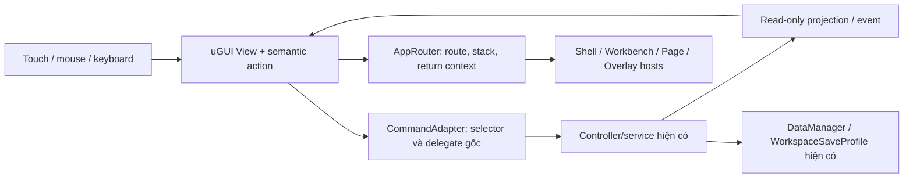

# Phase 02 — UI component architecture

Đề xuất cho Unity6000.6.4f1/uGUI2.6.0; chưa tạo C#, prefab, asset hoặc hierarchy. [Kiến trúc màn](new_ui_architecture.md), [navigation](navigation_flow.md), [feature map](screen_redesign_map.json).

## 1. Tách trách nhiệm



Chỉ bốn owner mới ở presentation: AppRouter, UIRegistry, OverlayHost và các adapter theo nhóm view. Không tạo singleton gameplay thứ hai, wallet mới hoặc một save system dành cho UI. Các tên/interface trong tài liệu là thiết kế, không phải API đang tồn tại.

View sở hữu RectTransform, graphics và input focus. Adapter sở hữu subscription và forwarding action. Service/controller gốc sở hữu luật, tài nguyên, state và persistence. Router không grant reward hoặc gọi Save mỗi khi mở một page.

## 2. Component catalogue

| Component/template | Dữ liệu đầu vào | Intent / output | State và invariant |
|---|---|---|---|
| AppShell | route snapshot; safe rect; presentation mode | open root/page/workbench | Một root mode; không tự đổi timeScale |
| PageFrame | title; resource context; body; footer; return context | Back; section select | Body cuộn, header/footer độc lập |
| WorkbenchFrame | tab ID; title; content; close callback | toggle/close/swipe/expand | Một sheet; body tự cuộn; footer tối thiểu144 |
| CoreDockTab | index0–4; selected; lockedReason | RequestWorkbench(index) | Locked entry có thông tin; không gọi command mở bị chặn |
| QuickAccessBar | bốn route; compact/inline mode | Kho/Bí cảnh/Vận khí/Mốc | Mode gọn có toggle/dismiss; cùng destination |
| ProfileWalletCluster | name/realm/tuvi/wallet read-only | avatar; resource info; settings | Không lấy mock online làm số dư production |
| QuestTracker | step/progress/reward; collapsed | claim/mốc; toggle; show guide | Giữ action và completion gate |
| SkillActionButton | skillIndex; mana; cooldown; unlocked | cast hoặc info | UI không suy diễn auto-cast; long-press không đồng thời cast |
| CostActionButton | label; formatted cost; canExecute; reason | gọi đúng một delegate | Không tính lại giá; block reentrancy |
| UpgradeCard | ID/level/current/next/cost/gate | select/detail/upgrade | Thiếu tiền/locked/max phân biệt bằng text+icon |
| BodyNodeCard | node index; parent/tier; lock/effect | select node | Hai nhánh; ID không phụ thuộc sibling render order |
| BodyNodeDialog | selected node; lore/current/next | x1/x5/max; close | Ba command riêng, giữ parent/realm/cost checks |
| FurnaceStatusPanel | brew state, recipe, realm, remaining | finish with dust | Busy/empty/completed khác nhau |
| PillVaultPanel | recipe×quality×count | dùng Tu Vi Đan | Không cho tự tiêu Đột Phá Đan ngoài luồng gốc |
| FormationCard | formation ID, level, selected/cost | learn/upgrade/select | Không gộp chọn với mua |
| SpiritActivationPanel | selected/active/cooldown | activate Spirit | Chỉ hiện/enable theo service |
| SlotVisual / LogicSlot | slot ID, item instance, gate | drag/drop/select | Logic slot không chứa child trang trí khi trống |
| ItemGrid / ItemRow | item ID/type/level/pieces/quality/count | existing per-item action / info | Giữ grid/list semantics và protect high-value |
| LootPreferencePanel |3 toggle của UI cũ | forward từng setter gốc | Bind không phát lại onValueChanged |
| RewardBreakdown | actual reward DTO; source | display | Không tự grant, không hard-code jackpot production |
| DecisionDialog | purpose; captured action; subject; caller | confirm/cancel | Confirm đúng context, một lần; backdrop=cancel nếu policy cho phép |
| DismantleDecisionDialog | exact item/reward/high-value | captured dismantle action | Không chạy action khi chỉ mở/đóng |
| OfflineRewardDialog | pending reward/ad readiness | x1/x2/close | Close/Back=x1; ad pending chặn dismiss |
| TrialArenaPage | type/run context/timer/score | actions theo đúng mode | Năm strategy view; không đổi luật mini-game |
| TrialResultDialog | granted result snapshot | CloseAll về hub | Không gọi grant trên OnEnable hoặc Confirm |
| AudioSettingsPanel | BGM/SFX/mute | handlers AudioManager | Reuse ở title/session, không tái tạo provider |
| SessionSettingsDialog | profile/slot/save request status | manual save/menu/quit | Lưu trước exit/reload theo callback gốc |
| InfoPopover | full text/stats; anchor | dismiss / optional explicit route | Tap đọc được; hover vẫn hoạt động trên PC |
| CombatNoticeFeed | log/banner/buff events | expand/collapse | Không biến mọi event thành modal |
| RouteErrorPanel | failed route/binding; retry | retry / known-safe return | Không replay giao dịch để thử lại view |
| DiagnosticsIndex | fixture/recovery references | developer-only preview | Không phát sinh command production từ control test |

Mỗi panel dùng slot Title/ResourceContext/Body/Footer và cùng state vocabulary: Unavailable, LoadingView, Ready, Empty, Locked, Insufficient, Maxed, Executing và Error. Không giả Pending server nếu chỉ có synchronous local command; không hiện tên kỹ thuật các state cho người chơi.

## 3. Component tree và dữ liệu

Một UpgradeCard gồm root background9-slice, InfoGroup (title/level/current/next), RequirementGroup, CostGroup và ActionArea. Card không chứa ví hoặc tự tăng level. CostActionButton nhận canExecute/reason từ adapter; khi click, command gốc vẫn kiểm lại điều kiện hiện hành.

Một Button có root RectTransform ổn định132/144+, Graphic child cho icon/label và press visual. Squash/scale chỉ child; không đổi hit rect. Disabled reason vẫn đọc được qua label hoặc info target riêng, không dựa vào onClick của Button.interactable=false.

PageFrame/workbench giữ reference typed tới body container, footer và resource fields. Data rows có key bền: item instance ID, node ID, formation ID, quest/achievement ID; không dùng index hiển thị sau filter làm ID command. Filter/sort/view mode không được thay item target của một dialog đã mở.

Projection tối thiểu:
```text
RouteState: routeId, surfaceMode, parameters, callerState, focusAnchor
CallerState: rootMode, workbenchId, sectionTab, filter, viewMode,
             pageIndex, scrollPosition, selectionId
ActionRequest: commandKey, stableSubject, originalSelector,
               capturedContext, viewGeneration
ReadModel: displayValues, canExecute, disabledReason, runtimeState
DecisionRequest: purpose, subjectSnapshot, confirmDelegate,
                 cancelDelegate, dismissPolicy, callerState
```

Các structure này chỉ phục vụ UI, không thêm trường vào CharacterSaveData hay đổi schema save. Route context được giữ trong session UI memory; chuyển slot/return title phải xóa context cũ. State của progression và rewards vẫn ở service/save gốc.

## 4. Binding ownership và lifecycle

- Bind một lần cho một view generation; unsubscribe đúng callback khi Unbind/OnDisable. Không đăng ký AddListener lặp mỗi lần mở.
- Chọn **một** binding owner cho mỗi button: persistent UnityEvent đã chuyển target hoặc runtime adapter, không cả hai cho cùng command.
- Không RemoveAllListeners trên control của owner khác. Khi thay view, tháo đúng delegate đã đăng ký.
- Gán Slider/Toggle bằng API không phát notification khi đồng bộ snapshot; một lần user toggle mới gọi setter/service.
- Không polling tất cả text mỗi frame. Dùng event hiện có OnChanged/OnUnlockStateChanged/wallet/progress; chỉ timer/cooldown/animated fill cần tick khi visible.
- Callback bất đồng bộ mang generation/context; view đã đóng không được reopen nhầm. Service vẫn có trách nhiệm hoàn thành transaction hiện có.
- Refresh list giữ filter/page/scroll và lựa chọn; clear/rebind theo key, không nhân đôi listener/card. Không bắt buộc thêm một pool UI mới trước khi đo; ưu tiên cơ chế phù hợp đã có.
- UI pending guard ngăn tap lặp; không tự retry grant/spend. Route retry chỉ dựng lại view và đọc snapshot.

Nguồn animation ưu tiên unscaled UI time,200ms sheet,120–180ms modal/page fade; input chỉ chuyển owner sau khi target đã bind. Interrupted transition hủy tween/coroutine cũ và dùng generation mới, không để invisible raycast blocker. Character modal trước dùng deltaTime: chuyển động unscaled là thay đổi presentation dự kiến, phải test timeScale0/.4/1.

## 5. Integration với implementation hiện có

| Nguồn cũ | Điều cần làm ở implementation sau | Phần phải giữ |
|---|---|---|
| MainMenuManager | Presenter/bridge nhận view refs; thay scan mọi Canvas và ShowPanel bằng router |3 slot, validate empty name, SaveData, confirm enter/delete/quit, BGM/timeScale |
| MobileDrawerUIController | Khi V3 bound, façade OpenDrawer(index)/Close chuyển vào AppRouter; không animate subtree cũ | index0–4, gate, tab toggle, close/backdrop/swipe/collapse |
| MobileUINavigationManager | Một Back dispatcher tới registered top layer khi V3 active; fallback cũ cho scene chưa migrate | Android Back/Escape và caller-specific close semantics |
| GameplayChoicesService | Inject ChoiceView/StyleView; không tạo external sorting Canvas riêng | choice consumption, style0/1, Lv2 gate,8 kills, reward/failure/save |
| TutorialManager/TooltipManager | Semantic anchor registry thay Find path/tên cố định; disable old auto-builder chỉ trong V3 mode | quest steps/claims/target actions; tooltip text và hover |
| Modal controllers | Inject content/label/button refs và register lifecycle với OverlayHost | original command/delegate/context; không tạo modal thứ hai |
| DaoAn/Storage/Achievement/Milestone factories | ContentHost và row binder thay implicit scene path | mỗi ID/filter/cost/gate/claim và scalar/array selector |
| SecretRealmPlayController | TrialHost injected; giữ5 strategy và result data; route exit/result đăng ký Back | entry consume, score/timer, action callback, grant-before-result, CloseAll |
| Cultivation/Skill/Stage/Combat UI refs | Rewire view refs hoặc read-only projection; không sửa công thức | value updates, fill/cooldown, boss/death/ready states |
| JadeUITheme và art hiện có | Đọc token/sprite như shared skin; không chạy generic layout scanner lên view mới | original art, Vietnamese font,9-slice semantics |
| DataManager/WorkspaceSaveProfile | Giữ owner/profile/persistence; UI adapter gọi action đang có | global/mobile/PC/QA isolation, session guards, migration/JSON fallback |

Đây không phải plug-and-play chỉ bằng đổi tên prefab. Các method private, path Find cứng, menu scan và auto-builder cần refactor phần presentation hoặc façade có nhánh V3. Không tạo đồng thời legacy UI builder và V3 binder. Scene PC/module PC không tự migrate; khi không có V3 binding, hành vi cũ phải tiếp tục.

Root alias Canvas có thể tạm giữ để tránh một số lookup gãy trong giai đoạn bridge. Việc giữ alias không đồng nghĩa giữ hierarchy cũ. UIRegistry cung cấp anchor keys và typed references; hoàn tất alias ledger rồi mới cân nhắc đổi root name.

## 6. Subtree kiếm phải giữ có lý do

MergeManager dùng inventoryPages/equipPanel, slot.childCount, GetComponentInChildren<MergeItem>, tên bắt đầu Equip và thứ tự capacity. Một slot có sẵn child icon/label/decor sẽ bị coi là không trống. Không đặt template trang trí bên trong logic slot.

```text
SwordWorkbench
  EquipmentLogicPanel                  # array/index0..9
    EquipSlot_0 [RectTransform, Image, MergeSlot]
      MergeItem                        # chỉ có khi thật sự có kiếm
    ...
  InventoryLogicPages
    Page_0                             # chỉ có LogicSlot children
      InventorySlot_0 [RectTransform, Image, MergeSlot]
        MergeItem                      # chỉ có khi có kiếm
      ...
  DecorationLayer                      # sibling overlays, theo reference slot
    Lock/emptyHint/selection visuals
  Header / scroll viewport / footer
```

Style background là Image trên root slot. Decor/empty text/lock visuals dùng sibling layer hoặc renderer không làm tăng childCount logic. Tên Equip và thứ tự slot không đổi; inventoryPages vẫn giữ model page thật. Giữ item GameObject/instance, currentPieces và originalParent; không thay bằng clone view mất MergeItem identity.

Nếu triển khai sau muốn tách hoàn toàn Transform topology khỏi logic, đó là một refactor riêng có test merge/equip/load/save đầy đủ; không mặc định làm trong redesign. Đây là phần hierarchy giữ lại vì implementation phụ thuộc, còn outer presentation thay mới.

## 7. Input và drag/scroll

Sheet swipe chỉ bắt đầu trong handle/header, loại trừ close/action button; không cướp drag trong ScrollRect hoặc item. Inventory vertical gesture và sword drag cần arbiter: drag handle/icon hoặc long-press bắt item, scroll body vẫn cuộn; touch chọn rồi chọn ô đích là phương án tương đương bổ sung. Thời gian/threshold phải kiểm tra trên máy thật, dùng đơn vị theo Canvas scale/EventSystem, không giả pixel ảnh=dp.

Touch info không phát cast/dismantle sau long-press. Pointer ownership theo pointerId, hủy drag khi modal/page interruption, trả đúng originalParent nếu không commit. Không reparent workbench compact→expanded giữa một drag chưa hoàn tất.

InputSystemUIInputModule/EventSystem và InputActions hiện có giữ một owner hợp lệ; keyboard submit/Back chỉ vào top focused view. Không tạo thêm EventSystem cho mỗi page. Skill hot/cooldown và mana overlay không nhận raycast độc lập đè lên nút cast.

## 8. ScrollRect và layout ownership

```text
PageFrame
  Header
  ScrollView [ScrollRect]
    Viewport [RectTransform + RectMask2D cho khung chữ nhật]
      Content [VerticalLayoutGroup + ContentSizeFitter vertical Preferred]
        Keyed rows
  Footer
```

Nếu cần mask hình đặc biệt dùng Mask+Image phù hợp; không chồng hai cơ chế mask vô ích. ScrollRect có refs Content/Viewport và scrollbar nếu dùng. ContentSizeFitter xác định chiều cao Content; VLG xác định chiều cao child; parent không đồng thời ép chính chiều cao Content. Grid có cell size/constraint rõ và nội dung cuộn đúng trục.

Body thật ngắn hiển thị EmptyState, không tạo row giả có command. Reopen giữ normalized scroll hợp lệ; đổi filter reset về đầu chỉ khi caller chọn filter khác, refresh wallet không kéo người chơi về đầu.

## 9. Error, confirmation và data corrections

- Dismantle host bắt buộc sẵn sàng trước khi gọi lệnh có fallback auto-confirm. Không clone nút confirm có null delegate hoặc dùng item index đã thay đổi sau sort.
- Offline SDK guard và grant-once giữ ở lớp hiện có. UI không grant ở OnEnable/OnDisable/animation complete.
- Result chỉ dùng actual granted RewardResult. Sample fallback jackpot đưa vào diagnostics có nhãn minh họa, không thay reward production.
- Character loadout counter lấy capacity/index đầy đủ thay /4; giữ mọi giá trị cũ và bổ sung phần đang bị thiếu.
- Kiếm Chủng copy phản ánh đúng4/6/8 theo code; không đổi drop/reward để khớp nhãn5–8.
- Save status phân biệt gửi yêu cầu và xác nhận ghi thành công. Nếu API void hiện có chưa trả outcome thì không tuyên bố đã sync server/đã xác nhận từ backend; manual save command vẫn giữ.
- Modal missing/bind error dùng RouteError, có retry view và return caller, không tự chạy lại transaction.
- Các thay đổi presentation/edge-case ở trên đều nằm trong acceptance delta của map; chưa được đánh dấu runtime pass.

## 10. Art, typography và accessibility

Tái dùng JadeGoldAtlas16 sprite và ImmortalRealmPortrait hiện có. Skin chỉ chứa art/token; text, giá, số dư, timer và game data không bake vào ảnh. Panel/button dùng9-slice/border hiện có; icons giữ aspect. Không tạo dependency hoặc font framework mới.

Dùng legacy Text/UiTextStyle/SourceSansPro hiện có để giữ reference/type và dấu tiếng Việt; migration TMP không phải điều kiện của kiến trúc này. Name/label dài được wrap/scroll hoặc ellipsis kèm cách đọc full; giá trị chi phí quan trọng không chỉ ellipsis. Wallet có bản rút gọn và full info.

State không dựa riêng vào màu: lock reason, insufficient cost, MAX, selected/claimed đều có chữ/icon. Text không nằm dưới gesture inset. Popover không phủ action bắt buộc; hit rect không chồng nút bên cạnh. Tooltip hover được bổ sung tap info, không biến hover thành yêu cầu trên điện thoại.

## 11. Cổng kiểm thử integration sau

| Nhóm | Acceptance bắt buộc |
|---|---|
| Binding | Mỗi FeatureID có target GUID/fileID thật;5 persistent events không mất; một tap một command |
| Menu/save |3 slot empty/occupied, tên Việt dài/rỗng, enter/delete cancel/confirm, no accidental save overwrite |
| Sword | drag/drop/invalid/max/equip swap/right-click/touch alternative,10 capacity, pages/quick/sort/sacrifice, save/load |
| Upgrade/craft |6 body nodes x1/x5/max,2 recipes/dust/pills,4 artifacts,6 formations/spirit; every gate/max/insufficient |
| Lists/claims | Inventory5 tabs/3 preference toggles/grid/list/high-value/pending; DaoAn8 filters; claim one/all tách dataset |
| Skill/choices |4 casts/mana/cooldown/locks; CD study path; styles; encounter reward/challenge/death/skip |
| Modals/Back | caller restoration, no click-through, top focus, trial running/result, missing-view retry |
| Rewards | offline x1/x2/unavailable/cancel/exception/duplicate callback; minigame grant exactly once |
| Time/input | timeScale0/.4/1, interruptions, drag/scroll, keyboard, touch/mouse, focus/pause lifecycle |
| Portrait |1080×1920,720×1280,1080×2340/2400,360×640,390×844, notch/home inset, long text/large numbers |
| Isolation | PC unchanged; correct save profile; default build list/PlayerSettings unchanged |
| Evidence | Editor screenshots + action assertions + physical-device QA; performance measured before claiming gains |

Phase 02 chỉ xác minh thiết kế/map, không thay cổng runtime này bằng số lượng hàng trong JSON.


## 12. Input ngoài GraphicRaycaster

Dimmer không tự chặn các script đọc Input/Physics trực tiếp. Bridge V3 phải đưa Router.IsGameplayInputBlocked vào query tương đương IsAnyModalBlocking của GameplayChoices/encounter/world-input; chặn thao tác tay dưới overlay nhưng không dừng chiến đấu tự động. Các canvas sorting tự sinh phải chuyển host trước khi bật V3; không dùng tăng sorting order để đè nhau. Với scene không có V3, query/path cũ tiếp tục hoạt động.

## Xác minh bàn giao Phase 02

- Đủ7.712/7.712 FeatureID,0 trùng/thiếu; callback/data/row hash gốc khớp;48 nhóm nguồn có mapping.
- 57 route và component đích hợp lệ;195 cạnh được kiểm tra, mapped route reachable theo production/development/lifecycle root phù hợp.
- Bốn tài liệu liên kết đúng, Markdown fence cân bằng; GUID/fileID đích còn null có chủ đích vì chưa tạo view.
- Mọi file có trước Phase02 giữ nguyên SHA-256; Assets/Packages/ProjectSettings, AGENTS, tài liệu Phase00/01, HEAD/branch/index không đổi.
- Scene mobile vẫn sạch,12 root; hash save hiện tại giữ nguyên so với đầu Phase02. Không so với save cũ của Phase01 vì người dùng có thể đã chơi giữa hai phase.
- Đây là xác minh coverage/thiết kế và bảo toàn nội dung; chưa triển khai hoặc chứng nhận runtime/thiết bị.
